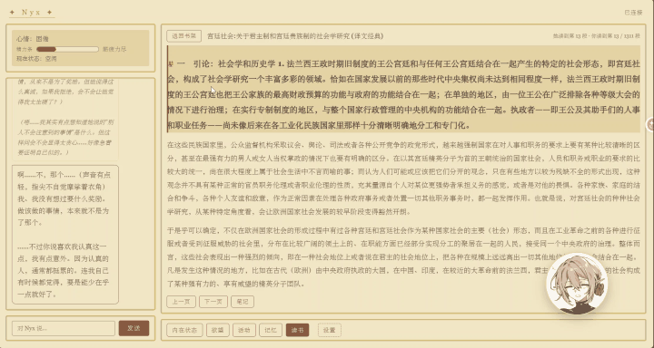
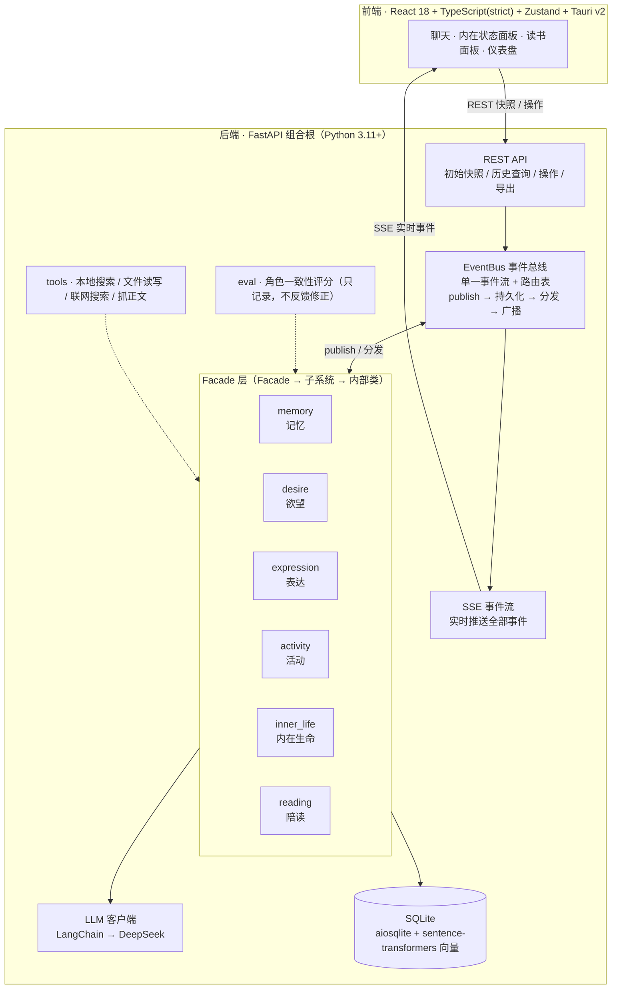

# Nyx Agent

<p align="center">
  
</p>

<p align="center">
  <a href="#"></a>
  <a href="#"></a>
  <a href="#"></a>
  <a href="#"></a>
  <a href="#"></a>
</p>

> 一个住在你电脑里的桌面 AI 同伴。她会观察你的状态、记住和你的每一次互动、生出自己想做的事，并在合适的时候主动搭话。
>
> 她的人格原型是小说《诺斯艾兰》的女主人公「尼克斯·夏本」，**明确知道自己是个 AI，并且想要成为人类**。这不是一个套壳聊天机器人——她有一套会演化的内在生命：欲望随时间涨落、记忆沉淀、性格与三观在反思中缓慢改变。

未完成事项统一维护于 [待办清单](docs/TODO.md)。

## ✨ 功能特性

### 🎭 角色卡与多角色陪伴

- **最多四个角色同时运行**（包含默认 Nyx）：标题区或桌宠菜单即时切换；切走后仍继续自己的活动、欲望和反思。
- **独立存档**：聊天、记忆、人格成长、任务、书库和阅读进度按角色保存。用户操作交给当前角色，已受理工作保持原归属。
- **角色管理**：设置中导入原生 `.nyxcard` / `.zip`，查看启动错误、重试、卸载和恢复；卸载保留存档。
- **观察边界**：共享在线/忙碌/离开状态；窗口标题、屏幕摘要和新的主动表达仅属于当前角色。

### 💬 对话与表达

- **快慢双通道回复**：快通道即时响应、只思考一轮；慢通道完整拼装——回溯上下文、检索相关记忆、生成场景化记忆，再经多轮「内心 → 说出口」递进续写。
- **主动搭话**：有互动欲时，Nyx 会主动发起对话，而不是永远等你开口。
- **碎碎念**：空闲时自言自语——关于她刚读的书、刚想起的记忆、冒出来的念头、关于你的事。

### 🧠 内在生命（可演化的人格）

- **情感**：valence / arousal 二维坐标 + 8 类情绪标签，由事件驱动、随时间衰减回基线。
- **性格 · 三观 · 精力 · 自我叙事**：Big Five、三观 4 维、精力 5 档，实时可视化。
- **反思是唯一的演化入口**：性格、三观、长期欲望、自我叙事只能被反思缓慢改变——像人一样，她不会一夜变脸。

### 🔥 欲望驱动的自主活动

- **两层欲望**：短期冲动（互动 / 探索 / 创造 / 休息）+ 长期野心（≤ 5），压力随时间涨落、达峰生成。
- **自主安排日程**：Nyx 自己决定此刻该做什么——读书、联网探索一个她好奇的话题、写点东西、发呆反思，或休息。
- **可打断、可续做**：你随时发消息打断她；有进度的活动（读书 / 创作 / 探索）会暂停保留进度，之后从断点续上。

### 📚 陪读（共读一本书）

- **EPUB 导入**：上传 EPUB，段落粒度解析、按进度续读。
- **读伴行为**：翻页冲动、主动提问、划线批注、读书笔记——她会像真人一样在阅读时冒出反应。

### 💾 记忆

- **短期 → 长期沉淀**：短期记忆「实际用进回复 3 次」升为长期；长期记忆不消失，只新鲜度下降。
- **场景化记忆**：每次慢通道对话沉淀一条「记忆内容 + 标签 + 总结」。
- **用户画像 + 矛盾检测**：逐步建立对你的理解；当新旧记忆冲突时，触发一次反思。

### 🔌 工具调用

- 本地磁盘搜索、文件读写、联网搜索（Bing）、抓取网页正文——慢通道回复和探索活动可按需调用。

### 🔍 可观测 · 可溯源

- **SSE 实时事件流**：全部事件实时推给前端，前端按类型增量更新各面板。
- **`correlation_id` 全链路溯源**：任何产出都能沿「用户消息 → 回复 → 记忆 → 反思」因果链回溯到源头。
- **仪表盘**：内在状态、欲望队列、活动日程、事件流、OOC 评分一目了然。

## 🧭 系统架构



六个 Facade 不直接互调，全部通过 `EventBus` 解耦；三个外部输入（用户消息、时钟 tick、观察状态）经组合根 `publish` 进总线，产出统一广播给前端。

上图表示单个角色的运行框架。宿主管理当前选择、角色生命周期和共享观察；每个角色拥有独立 SQLite、EventBus、Facade 和工作目录，共享模型资源。重试与故障恢复按角色处理。

## 🚀 快速开始

### 环境

- Python 3.11+
- Node.js 18+（前端）

### 一键启动（开发）

```bash
python dev.py        # 同时拉起后端(8000) + 前端 Vite(5173)，Ctrl+C 退出
```

启动器会检查旧 Nyx 实例、端口和本次后端身份；未知程序占用 8000 时拒绝启动。浏览器访问 `http://localhost:5173`，Ctrl+C 停止服务。

`python dev.py` 与 `python dev.py --desktop` 在开发模式下监测后端及现有配置变化；前端由 Vite 热更新。关闭启动器会清理它启动的进程。

桌面开发使用：

```powershell
python dev.py --desktop
```

### Windows 桌面构建

```bash
pip install -e ./packages/nyx-harness -e ".[desktop-build]"
python dev.py --build-sidecar
cd frontend
npm run tauri build
```

构建会下载官方本地 embedding 模型，并冻结 Python 后端、公开 `config.yaml`、`nyx/prompts/` 和内置 `nyx/cards/`，不包含 `.env`。桌面包只启动并管理自己的后端，API Key 由运行环境提供；检测到旧 Nyx 启动器时会先结束其进程树再接管，未知程序占用 `8000` 时拒绝启动。sidecar 启动后必须通过固定 Nyx 服务标识与本次随机 nonce 的 `/api/ready` 身份握手，不能仅凭端口可连接确认后端。关闭桌面应用会通过 stdin 管道通知后端退出，超时后仅回收自己启动的进程。各平台打包 REST/SSE smoke 验收未全部完成，不将开发验收等同于可发布。

### 后端

```bash
pip install -e ./packages/nyx-harness -e .

# 配置 API Key（写入 .env，已被 .gitignore 覆盖；默认 DeepSeek）
cp .env.example .env
# 在 .env 中填写 DEEPSEEK_API_KEY；不要把真实值写进命令或提交记录

python -m nyx.main        # 默认监听 8000，加 --reload 自动重启
```

### Docker Compose（本地 PostgreSQL）

Compose 会启动 Nyx 和 PostgreSQL，并把数据保存在命名 volume 中。先复制环境模板，
再在本机生成根 token；不要把 `.env`、数据库密码或任何 API key 提交到 Git：

```bash
cp .env.example .env
python -c "from pathlib import Path; import secrets; p=Path('.env'); s=p.read_text(); p.write_text(s.replace('NYX_AUTH_TOKEN=', 'NYX_AUTH_TOKEN=' + secrets.token_urlsafe(32), 1))"
docker compose up --build
```

PowerShell 等价写法：

```powershell
Copy-Item .env.example .env
$token = python -c "import secrets; print(secrets.token_urlsafe(32))"
(Get-Content .env) -replace '^NYX_AUTH_TOKEN=.*$', "NYX_AUTH_TOKEN=$token" | Set-Content .env
docker compose up --build
```

Compose 要求 `.env` 中提供 `NYX_AUTH_TOKEN`；`DEEPSEEK_API_KEY` 可按需填写。
应用默认发布在 `http://localhost:8000`，停止时执行 `docker compose down`；需要清除
本地数据库 volume 时才使用 `docker compose down -v`。

### Railway（生产）

生产部署使用 Railway 应用、托管 PostgreSQL 和挂载到 `/app/data` 的持久化卷。先在
Railway 项目中创建 PostgreSQL、Nyx 后端和前端服务，再在 Railway Variables/Secrets
中配置变量；Secret 值只在 Railway 控制台生成或粘贴，不写入仓库：

- 后端：`NYX_DATABASE_URL`（引用 PostgreSQL 提供的连接 URL）、`NYX_AUTH_TOKEN`、
  `DEEPSEEK_API_KEY`、`NYX_PUBLIC_ORIGIN`（前端 HTTPS 地址）。启用 QQ 时再配置
  `NYX_ONEBOT_WS_URL` 和 `ONEBOT_ACCESS_TOKEN`。
- 后端 Volume：挂载到 `/app/data`。
- 前端：`NYX_BACKEND_URL` 使用 Nyx 后端的 Railway 私网地址（例如
  `http://<backend-service>.railway.internal:8080`）。前端公开域名作为后端的
  `NYX_PUBLIC_ORIGIN`，由 Railway 提供 HTTPS。

部署前确认 Railway CLI 已登录并已链接目标项目；从仓库根目录执行：

```bash
railway up . --service nyx-desktop-agent --environment production
railway up frontend --path-as-root --service nyx-frontend --environment production
```

部署后先访问前端公开 URL，再用已授权的客户端验证 `/api/state` 和 SSE `/api/events`。
不要在终端、提交记录或 README 中输出 `NYX_AUTH_TOKEN`、`DEEPSEEK_API_KEY`、
`ONEBOT_ACCESS_TOKEN`、PostgreSQL URL 或备份内容。

### 前端

```bash
cd frontend
npm install
npm run dev        # Vite 开发服务器 5173，/api 转发到 8000
npm run tauri dev  # 桌面壳（Tauri v2）
```

## ⚙️ 配置

`config.yaml` 按块组织（`llm` / `embedding` / `memory` / `desire` / `activity` / `expression` / `exploration` / `vision`），Facade 从配置装配，改配置不用改代码。

### 制作与导入角色卡

复制 `nyx/cards/nyx/` 作为模板，修改 `card.yaml` 的 `id`、`name`、初始人格及 `identity`，并改写 `canon.md`。ID 必须是稳定的小写标识，不能与已有角色重复。长期欲望可设为 `long_term_desires: []`；不使用图片时设 `assets: {}` 并移除资产目录，界面会显示角色名称占位。

将这些文件直接压到 ZIP 根目录（不要多套一层文件夹），命名为 `.nyxcard` 或 `.zip`，在设置的「角色管理」导入。必需文件为 `card.yaml` 和非空 `canon.md`；`character-reference.md`、`ask.md`、`assets/` 可选。压缩包和解压总量分别限 50 MiB；首版不支持 SillyTavern 卡、原地更新卡片或复制存档。字段与校验规则见 [角色卡契约](docs/specs/14-character-cards.md)。

默认 Nyx 保留原数据库和工作目录；新角色保存到 `data/characters/<id>/`，宿主索引为 `data/characters/host.db`。卸载只停止运行并释放名额，再次恢复沿用存档；初始人格和欲望只写入一次，不覆盖成长。

## 🛠 技术栈

| 层 | 技术 |
|---|---|
| 后端 | Python 3.11+ · FastAPI · LangGraph · SQLite（aiosqlite）· sentence-transformers |
| 前端 | React 18 · TypeScript（strict）· Zustand · Vite · Tauri v2 |
| 质检 | ruff · pyright · pytest（1248 项通过，1 项跳过）· Vitest（336 项通过） |

## 📖 文档

| 文档 | 内容 |
|---|---|
| [`docs/design/design.md`](docs/design/design.md) | 产品定位、长期架构原则和文档边界 |
| [`docs/TODO.md`](docs/TODO.md) | 唯一待办入口：质量门、实机验收、部署与后续决策 |
| [`docs/canon.md`](docs/canon.md) | 人格设定（尼克斯·夏本） |
| [`docs/tech-reference.md`](docs/tech-reference.md) | 源码、spec 与 fact 的快速索引 |
| [`docs/specs/`](docs/specs/) | 每项功能的设计契约（spec 先行） |
| [`docs/facts/`](docs/facts/) | 当前源码事实摘要（只作快速导航） |

## ✅ 本地测试与检查

```bash
pip install uv==0.12.18
uv sync --locked --extra dev
uv run --no-sync python -m ruff check nyx/ packages/ tests/ scripts/
uv run --no-sync python -m pyright nyx/ packages/ tests/ scripts/
uv run --no-sync python scripts/run_e2e.py --timeout 300
uv run --no-sync python - <<'PY'
import os
import tempfile
from pathlib import Path

import pytest

with tempfile.TemporaryDirectory(prefix="nyx-release-check-") as directory:
    os.environ["COVERAGE_FILE"] = str(Path(directory) / ".coverage")
    result = pytest.main([
        "-q", "--cov=nyx", "--cov-report=term-missing", "--cov-fail-under=90",
    ])
raise SystemExit(result)
PY
```

验证产生的探针、日志、截图、报告、覆盖数据和临时数据库使用临时目录，成功或失败结束后自动清理，仅归档必要结论；正式构建制品按打包流程保留。冒烟验证失败时在终端显示后端日志末尾。

测试不依赖真实 LLM 或已安装桌面端；LLM 使用 mock，文件测试使用临时路径。覆盖率门槛保持 90%，当前缺口见 [待办清单](docs/TODO.md)。

前端测试与构建在 `frontend/` 中执行：

```bash
npm ci
npm test -- --run
npm run build
```

桌面壳变更还需在 `frontend/` 中执行 `cargo test --manifest-path src-tauri/Cargo.toml --lib --locked`
和 `cargo check --manifest-path src-tauri/Cargo.toml --release --locked`。
手动构建桌面包后，在仓库根执行 `uv run --no-sync python scripts/check_release_version.py`
和 `uv run --no-sync python scripts/smoke_release.py`，分别验证版本一致性与冻结制品的 REST/SSE、身份握手及退出回收。

网页问卷任务使用 Playwright 打开可见浏览器。Windows 优先使用已安装的 Microsoft Edge；其他系统或未安装 Edge 时，先运行 `uv run playwright install chromium`。在设置中开启联网探索后，可在活动页提交公开问卷 URL，或在聊天中让 Nyx 填写。任务完成结果保存在活动页；登录与验证码页面不自动填写。

## 📋 功能边界

- **本地单用户**：无端到端加密、无用户认证 / 多账户、无企业级审计日志。
- **eval 只记录不自动修正**：OOC 评分用于可视化，不反馈回 LLM。
- **探索是线性的**：联网自由探索 =「搜 → 抓正文 → 总结」，不做逐层地牢 / 决策支 / 托管。
- **电脑控制（computer use）尚未实现**：输入模拟闭环属 V3 backlog。
- **出站请求仅 LLM API + 联网搜索（opt-in）**，不上传用户数据。
