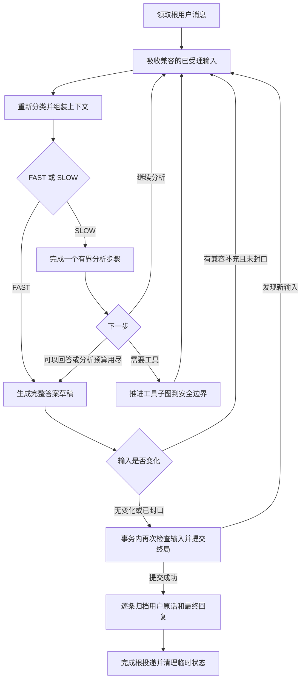

# 对话期间追加输入与分步思考：V1 设计与实施方案

> 状态：完整方案已获用户确认，2026-11-05；代码已实施，验收结果见文末记录。
> 本文定义跨表达、工具、归档和前端的续接契约，不内联实现代码。
> §11、§12 是验收要求；未执行的真实模型、页面或 PostgreSQL 验收不能以自动 fixture 代替。

## 1. 目标与需求复述

用户发送消息后，尼克斯思考期间仍可接收补充。她按有界步骤推进分析，在安全边界吸收新消息、重新审视接下来怎么做，保留已有分析摘要和已完成的工具结果，最后针对本轮收纳的消息统一回复。

用户故事：作为用户，我想在尼克斯尚未回复时继续表达和纠正自己的意思，让她结合完整输入再回答，同时保留此前已经取得的有效进展。

“重新开始、前面的思考不断”的准确含义是：重新判断目标和后续步骤，而不是清空全部过程，也不是坚持原结论。此前分析是待复核的模型判断，已完成工具结果是执行事实，两者必须分开。

例如：

1. 用户：“周末去哪玩？”
2. 尼克斯开始考虑目的地。
3. 用户：“预算三百。”
4. 尼克斯保留已有候选，重新检查预算。
5. 用户：“我今天腿疼。”
6. 尼克斯重新检查交通和步行量，交付一份综合回复。

第一版采用内部的分步分析，不实时展示中间分析文本。正常 THINK 和最终 SPEAK/ASK 仍在终局一次提交；最终的角色内心话不等同于内部分析日志。

### 元信息

- 前置契约：01-types、03-llm、04-module-bus-system、06-memory-system、10-eval、11-expression、14-character-cards、15-discussion-partner、18-plan-and-execute、21-onebot-transport、25-hosted-storage-and-postgresql。
- 前端契约：01-sse、02-stores、03-chat-panel、05-client。
- 架构：复用 `ExpressionFacade`、现有回复图、工具子图和 `expression.user_message` FIFO worker，不建立第二套聊天调度器或 Service/Manager 层。
- 技术栈：Python 3.11+、FastAPI、LangGraph、现有 SQLite/PostgreSQL 适配；React 18、TypeScript strict、Zustand、REST/SSE。
- 执行方式：完整方案获用户明确批准后，在当前会话按测试驱动方式逐项实施；本方案不自动创建提交、部署或启动并行代理。

## 2. 调查结论与可复用实现

| 当前实现 | 证据 | 本方案的处理 |
|---|---|---|
| 输入框可预打文字，但按钮、回车和 store 都在 `isReplying` 时禁止发送 | `frontend/src/components/chat/ChatInput.tsx`、`stores/chatStore.ts` | 拆开 HTTP 提交锁与等待回复状态 |
| 只有一个 `pendingId`、一个回复 timer；已处理 SSE 早于 POST 的情况 | `frontend/src/stores/chatStore.ts` | 改为按消息 ID 追踪，保留早到回执与角色代数保护 |
| Chat API 已先 durable admission，再返回原始消息 ID | `nyx/api/routes.py:api_chat` | 所有补充继续走相同入口，不只放进前端内存 |
| 同一表达消费者串行执行，handler 会一直等待 `reply()` 完成 | `nyx/events/bus.py:_consumer_worker`、`nyx/runtime.py:on_user_message` | 由正在运行的回复在步骤边界读取已受理的后续消息 |
| FAST/SLOW 正常文本均缓存到终局；外层回复图不持久化 | `nyx/expression/pipeline.py`、11-expression、18-plan-and-execute | 保留终局边界，内部分析摘要先只保存在本次调用状态 |
| 慢通道已有 plan/execute、checkpoint、调用去重和执行回执 | `nyx/expression/tool_pipeline.py` | 保留已完成结果，刷新新输入和后续计划，不清空调用账本 |
| 存在 checkpoint 时强制恢复慢通道；副作用未确认进入 uncertain | `pipeline.py:classify`、`tool_pipeline.py:execute` | 继续遵守，追加输入不能绕过 |
| 用户历史在回合末写入，启动时按事件恢复；终局重放入口当前直接短路 | `facade.py:restore_history`、`pipeline.py:record_message`、`runtime.py:on_user_message` | 支持多条输入；终局后重放先补归档，再完成投递 |
| 原始对话归档目前直接追加 `raw_event_ids/raw_content`，没有事件 ID 唯一约束 | `nyx/memory/facade.py:append_conversation_turn`、`segments.py:append_turn`、`store.py` | 新增逐轮归档索引，与段写入同事务；稳定 ID 本身不能证明幂等 |
| SSE 按 `event_seq` 提交序读取，普通 consumer 当前按 timestamp/id 排序 | `nyx/events/bus.py`、04-module-bus-system | 仅表达用户消息消费者改为提交序，避免外部旧时间戳抢到合并根消息前面 |
| 同一角色的桌面、浏览器和启用的本人 QQ 使用同一对话历史 | 14、21 契约及 `nyx/transports/onebot.py` | 同一角色的兼容用户消息进入统一候选集，保留来源和原始时间 |

当前源码、11-expression 和 06-memory-system 已不为新聊天产生场景记忆请求；部分总线旧段落仍有旧措辞。本方案不会据旧措辞恢复该路径，文档同步时明确本功能的实际边界。

只靠放开发送按钮会得到逐条回答；只增加“请一步步思考”的提示词无法把后来消息送进已经发出的请求。每次追加都取消整条任务，则会放大工具结果未确认、重复执行和上下文丢失的问题，因此选择安全边界续接。

## 3. 范围、假设与产品行为

### 3.1 回合归属

- 一条用户消息只有在服务端受理成功后才参与处理；输入草稿不参与。
- `root_event_id` 为当前表达消费者领取的首条用户消息 ID。本轮输出的 `correlation_id` 继续使用它。
- 每条补充保留自己的 event ID、原始 `correlation_id`、正文、时间和来源，不改写成根消息。
- 候选按 `event_seq` 排序。消息时间继续按原事件展示，不能为排列方便改成接收时间。
- 终局事务提交前，兼容的新消息可进入当前回合；提交后受理的消息属于下一回合。
- 屏幕上的逐字动画不影响该边界。答案已提交、仍在逐字展示时，新消息进入下一回合。

### 3.2 合并条件和队列边界

| 输入情况 | 处理 |
|---|---|
| 普通消息，`discussion` 三态与根消息相同，无批注，无新的问题目标 | 合并当前回合；不根据“是不是同一话题”自行拒绝 |
| 补充中用自然语言纠正、补充或更换目标 | 保留原消息，让模型依据新输入重新判断 |
| 根消息在自动模式，补充使自动意图判断命中讨论 | 重新分类并按现有权限加载讨论技能；清除旧授权下尚未执行的工具请求 |
| 显式将 discussion 从 null/true/false 切换为另一个值 | 从该消息开始排入下一回合，保留当前回合授权语义 |
| 指定与当前已认领 attempt 相同的 `reply_to` | 可作为同一回答的补充，不再次认领 |
| 明确指定另一个 `reply_to` | 从该消息开始排入下一回合，不抢占当前 owner |
| 批注消息 | 独立回合；不与普通输入或另一批注合并 |
| 当前回合本身是批注 | 该回合只处理原批注，后续消息排队 |
| 另一个角色的消息 | 由所属角色独立处理 |

遇到第一条不兼容输入即停止向后吸收，不能越过它去合并更晚的消息。未被当前回合收纳的消息继续保留原 delivery，随后按序处理。

### 3.3 有界处理

- Chat POST 单消息沿用现有 12000 字符校验。当前 OneBot 入口没有同样的长度上限，不能把 API 校验误写成全入口保证；本功能不顺带改变其准入。OneBot 或旧日志中已受理的超长消息按下述兼容边界处理。
- 每个合并回合最多收纳 32 条用户消息、正文合计最多 24000 个 Unicode 字符，取最先达到的边界。这两个数是本方案定义的固定资源边界，不新增配置项。
- 不能完整放入的下一条消息连同其后消息进入下一回合，不截掉正文，也不声称已纳入。
- 若根消息本身来自 OneBot/旧日志且超过 24000 字符，独立处理这一条并立即封口，保留原文；这是输入合并预算的明确旧入口例外，不宣称它符合 24000 字符回合上限。它不能作为补充挤入前一回合，不新增静默截断或丢弃；模型容量不足仍走原回复失败/fallback。
- 当前输入一旦因条数、字符或不兼容消息封口，本轮只回答该前缀；后续输入不会让该回合无限延期。终局回执必须准确列出实际覆盖范围。
- 简单消息保留 FAST 一次完整生成；复杂消息采用分步分析。单回合额外分析调用最多 3 次，每步有效摘要最多 1000 个 Unicode 字符；发起调用即占一次预算，包括非法输出或调用失败，不只计算成功步骤，追加不重置次数。
- 最终回复的既有 `slow_max_rounds` 上限继续约束同一输入版本的续写；输入变化时丢弃旧版本的未发布答案。最多 32 条输入使版本刷新次数有界。
- 工具判断、结果项数、自动重试和自主重规划继续使用既有预算；追加输入不能补满这些预算。

### 3.4 第一版的连续性承诺

- 当前回复调用中保留此前分析摘要及其输入版本；新输入到来后，旧摘要标为“基于旧输入、需复核”。
- 保留已完成工具结果、参数和执行状态；新信息只改变这些结果是否仍与问题有关。
- 未发布的旧答案不进入正式历史，也不作为“尼克斯已经说过”的内容回注。
- 进程退出或 handler 重试后，允许重算未提交的内部分析；原始用户消息与工具执行进度仍由既有持久机制恢复。这沿用当前外层回复图不持久化的边界。
- 不承诺逐 token 修改正在进行的模型请求，也不通过取消外部工具来实现续接。
- 第一版不增加实时思考进度文本、思考时间延迟、自动防抖等待、停止按钮或语音入口。

## 4. 回复流程与状态

### 4.1 运行期对象

在现有 `ReplyState` 中增加本轮输入和分析字段，不新增调度类：

| 字段 | 含义 |
|---|---|
| `input_mode` | `durable` 或 `direct`，在 reply 入口根据真实根 USER_MESSAGE 是否存在确定；查询失败不能降级成 direct |
| `input_events` | durable 模式为按提交序排列的原始用户事件快照，首项是根消息；direct 模式为空，不合成用户事件 |
| `input_revision` | 本次调用内单调增加的输入版本；每次吸收一批消息加一 |
| `input_closed` | 是否因资源边界或不兼容消息停止继续收纳 |
| `request_start_index` | 当前有效请求在 `input_events` 中的起始下标，按 §4.5 的明确撤回/替换规则计算 |
| `retrieval_query` | 当前输入版本的有界检索文本，按 §4.5 计算，不能沿用旧版本 query |
| `tool_exit_reason` | 工具子图最近一次交还原因：`complete` 或 `input_pending`；不表示整轮回复已完成 |
| `reasoning_steps` | 有界的结构化分析摘要，每项记录 step ID、输入版本、摘要和生成时间 |
| `reasoning_step_count` | 本回合已用分析次数，不因追加清零 |
| `draft_revision` | 当前答案草稿对应的输入版本 |
| `committed_reply` | 本次 finalize 确认已提交的终局 Event 快照；只在 committed/replayed 后赋值，direct 归档也从这里取实际交付正文 |

`message` 是 §4.5 定义的有效请求派生文本，供分类和回溯选择使用；检索使用独立的 `retrieval_query`。prompt、历史和溯源必须使用分条的全部原始输入；不能把多条消息伪装成一个时间点的原话。

### 4.2 分步分析输出

新增内部 `reason_step` 节点，经统一 `LlmClient.complete()` 使用 JSON 输出，应用层字段为：

| 字段 | 规则 |
|---|---|
| `summary` | 非空、最多 1000 字符的工作摘要，表达当前理解、待确认约束与下一步考虑 |
| `next_action` | `continue`、`tools`、`answer` 三选一 |

步骤 ID、输入版本、时间由程序写入，不能信任模型自行填写。摘要不是权威事实，也不要求模型吐出详尽的原始推理链。

摘要及动作合法才推进；解析非法或分析调用失败时停止额外分析，用原始输入和已确认结果进入最终回复。checkpoint、回执或数据库错误必须传播，不能伪装成可忽略的分析失败。最终回复生成失败仍走现有 fallback。

`reasoning_step_count` 在每次调用前递增；调用已发起后即使返回非法 JSON 也不能退回名额。不新增“分析解析重试”绕过三次上限。正常取消继续传播，不转换成 fallback。最终生成失败产生 fallback 草稿后，后续补充仍可按原规则吸收，但只更新其覆盖版本并提交失败提示，不因每条补充再发起失败的模型调用；数据库提交错误仍交 delivery 重试，不能当成模型失败。

SLOW 中所有工具调用都留在现有工具子图内；`reason_step` 不能直接执行工具。`tools` 在工具预算用尽、上次 uncertain 或没有可用工具时降为 `answer`，并把实际限制传给最终回复。

### 4.3 收到补充后的处理

1. 原子读取后续 pending 输入，收纳连续的兼容前缀，推进输入版本。
2. 保留分析摘要，标明它们所属的旧版本；要求下一次模型调用结合新输入重新检查旧判断。
3. 清除旧答案草稿、旧续写正文和尚未执行的旧工具请求。
4. 重新分类、检索并组装上下文；讨论授权、阅读上下文和事实边界继续按既有契约计算。
5. 有分析预算则继续分析，没有则基于全部收纳输入和已有证据直接生成最终答案。

同一步分析正在调用模型时收到多条补充，可在其返回后一次吸收。已经完成的摘要仍可留作旧版本参考，但旧动作在复核前不得执行。

### 4.4 统一终局节点与接口边界

当前 FAST、SLOW、问句和 fallback 分别在 `respond`、`should_ask` 内提交事件；实施时收敛到现有回复图中的一个 `finalize_reply` 节点。生成、问句识别和续写节点只产出草稿；只有该节点可以提交用户回复终局，提交成功后才进入 `record_message`。

| 接口 | 拟定签名与语义 |
|---|---|
| 用户回复入口 | `ExpressionFacade.reply(...) -> None` 保持现有调用签名，按根事件读取真实输入；无根用户事件的既有内部调用按 §4.6 走 direct 单消息兼容路径 |
| 终局协调 | `ExpressionFacade._finalize_user_reply(state: ReplyState) -> Literal["committed", "refresh", "replayed"]`；分别表示提交成功、需要吸收补充、已经存在终局 |
| 归档协调 | `ExpressionFacade._archive_user_reply(root_event_id: str, state: ReplyState \| None = None) -> None`；durable 模式从终局及覆盖列表读取原话和交付文本，state 只补运行期元信息；direct 模式必须提供 state 原文，具体见 §4.6 |
| 图路由 | `refresh` 返回收集/分类，`committed` 和 `replayed` 进入幂等归档；数据库错误继续抛出 |

finalize 成功或发现已有终局时，把实际终局事件放入 `committed_reply` 后才进入归档；refresh/回滚时该字段为空。这样 direct 兼容调用即使没有可回读的根事件，也有明确的已提交正文交接，不依赖“最后一段 speak”或未经提交的草稿。

不修改主动提问/读书提问的公开 `register_question(...) -> str` 返回语义。用户终局中的 canonical ASK 由统一终局节点准备，复用现有 attempt、事件构造和事务写入逻辑，使新问句与输入核对在同一次事务内完成；不能先调用会自行提交的公开提问方法。

外层图的 `recursion_limit` 按本方案有限输入版本数、分析次数和续写上限覆盖合法最长路径，不沿用可能提前触发的默认值；业务预算仍由状态机控制，不能用提高框架阈值替代预算。验收包含多次追加和最大合法路径，避免普通续接意外进入 GraphRecursionError/fallback。

### 4.5 多条输入的分类、撤回与检索派生

派生只在外层吸收输入后执行，由纯函数计算；不新增一个 LLM 意图判定请求。原始事件始终保留，撤回旧目标不代表删除原话或遗忘已发生的工具动作。

**有效请求规则**

1. 默认 `request_start_index=0`，所有已收纳消息按提交序参与有效请求。
2. 仅为识别控制语句，去掉每条消息首尾空白，以 `，,。.!！?？；;` 和换行切分子句，取第一个非空子句并再去掉其首尾空白。**完整子句必须与整任务控制短语相等**才表示替换此前目标，固定短语为：`取消整个任务`、`撤回整个任务`、`替换整个任务`、`取消刚才的任务`、`撤回刚才的任务`、`取消前面的请求`、`撤回前面的请求`、`换个话题`。不做前缀、子串或引文内匹配；“不要取消整个任务”“取消刚才的任务里的杭州行程”均不命中。
3. 有多次替换时，选择最后一条命中消息的下标。有效请求为从该下标至末尾的原文逐条以 `\n\n` 拼接；保留控制句自身，不删除其中的否定词。没有替换时就是所有原文的有序拼接；字符上限仍由 §3.3 的输入上限约束。
4. `算了`、`不用了`、`改成`、`改为` 不属于整任务控制短语。“算了一下，预算三百”是补充，“改成周日”“预算改为二百”默认是局部纠正；程序保留原目标和其他约束，模型结合全量消息更新对应部分，不能把整条旧请求标成撤回。
5. 这是 V1 明确、有限的完整控制语句规则；不声称纯函数能识别任意自然语言撤回。“算了，只陪我聊聊”等未命中整任务控制语句的表达仍交给模型理解其最新意图，但不因此清空程序的有效请求集合或自动撤掉 skill。若需确定地更换整个任务，使用上述完整控制语句；不得靠继续扩大模糊前缀覆盖。

`derive_request_text(messages: Sequence[str]) -> tuple[int, str]` 放在现有 `classifier.py`，返回起始下标与派生正文。`classify_user_intent(message)`、`classify_channel(message, ...)` 和 `build_backtrack_context(message, ...)` 使用该正文。后续 prompt 仍含全部输入，额外标明哪些早期消息已被明确撤回、哪些是当前有效请求，要求以较晚纠正为准。

**讨论授权规则**

- 三态沿用根消息：`true` 强制加载，`false` 禁用，`null` 才对派生正文调用现有 `should_load_discussion()`。不对所有原消息做 OR，也不只看最后一句，普通补充不应无故撤掉前文的讨论意图。
- 每次输入版本变化都从原始输入重新派生、重算 skill 和工具 schema，不能沿用旧 `skill`。授权来自“讨论 skill 或默认池”与当前注册表的交集；执行前还要复查交集。
- 存在旧工具 checkpoint 仍强制进入 SLOW 以完成执行事实恢复，但 **SLOW 本身不授予讨论工具**。有效请求变为闲聊时，可以保留旧结果并直接回答，不能据旧计划继续调用讨论工具。

| 已收纳输入（均为自动模式） | 有效请求和确定预期 |
|---|---|
| “分析一下” → “取消刚才的任务，只陪我聊聊” | 仅后一句参与分类；自动讨论为 false。单独“分析一下”按现有保守识别也不必然命中讨论 |
| “分析一下为什么会这样” → “预算三百” | 两句均参与；自动讨论仍为 true，预算不能丢失 |
| “分析一下为什么会这样” → “取消刚才的任务，只陪我聊聊” → “今天有点难过” | 后两句参与；自动讨论为 false；保留已执行事实，清除旧授权下未执行请求 |
| “周末去哪玩？” → “不要超过三百” | 两句均参与；后一句是新增约束，不撤回目的地问题 |
| “周末去哪玩？” → “算了一下，预算三百” | `request_start_index=0`；两句均参与分类/检索，原问题不标撤回，预算作为新增约束 |
| “周六去杭州，预算三百” → “改成周日” | `request_start_index=0`；两句均参与分类/检索，杭州和预算保留；模型更新日期，不删除旧请求 |
| “周六去杭州，预算三百” → “替换整个任务，帮我安排周日去苏州” | 起点推进至第二句；旧杭州任务退出有效请求，不能擅自把旧预算当作新任务必需约束 |

**300 字符检索预算**

`build_reply_query(messages: Sequence[str], prior: Sequence[str]) -> str` 放在现有 `prompt.py`，传入有效请求消息和最多最近三条历史消息。固定 300 个 Unicode 字符预算，按以下顺序装入，不先拼全量再取尾部：

1. 优先放最新一条有效请求消息；其长度不超过 300 时完整放入。超过时保留前 150 字符、`…`、后 149 字符，保证开头的撤回/否定和末尾约束均有片段。
2. 有余量时，向前逐条放入更早的有效请求，再放最近的历史消息；各片段用一个换行分隔，换行也计入预算。历史候选仍只取各条前 120 字符。当前轮明确撤回之前的消息、内部分析摘要和旧草稿不能混入 query。
3. 下一条放不下时，在余量内按同样“头部 + `…` + 尾部”规则压缩；扣除换行后的正文预算为 b 时，头部取 `ceil((b-1)/2)` 字符、尾部取 `floor((b-1)/2)` 字符，中间省略号占一字符。连换行与三个正文字符都容不下时省略该条并停止。短的新纠正必须完整保留；长消息只承诺上述有界片段，完整原话仍进入正式 prompt。
4. 有效请求经现有 `strip_recall_fillers()` 判空时，query 为空，不让历史文本单独触发召回。语义查询不因空 query 自动退回旧目标。

对话段、LESSON、事实检索和工具重规划的经验召回统一使用当前 `retrieval_query`。事实召回的 `is_fact_query()` 先检查有效请求完整正文，实际查询仍用有界 query；讨论 skill 下继续禁用隐式事实/段召回。`respond` 刷新失败经验时同样使用新版 query，不能重新用未截断的旧 `message` 绕过此规则。工具规划/最终回复看到的分条用户输入不受这 300 字符检索预算裁剪。

### 4.6 无根用户事件的 direct 单消息兼容路径

`reply(msg, correlation_id, ...)` 的既有直接调用不保证先发布 USER_MESSAGE；`tests/test_expression/test_expression_facade.py` 的 `test_reply_fast` 等已覆盖此入口。有数据库但查不到原始用户事件，与没有数据库是不同情况，不能因为有数据库就强制走依赖原事件的归档。

**入口判定**：读取 `get_event(correlation_id)`，存在匹配的根 USER_MESSAGE 则固定为 durable；确实不存在则固定为 direct；读库失败继续抛出，已有同 ID 的其他类型事件视为错误，不能借 direct 绕过。durable 模式中途丢失根事件仍报错，不切换为 direct。该模式仅兼容原内部调用，不新增 HTTP、OneBot 或公开请求参数；真实用户入口仍必须 durable admission。

| 边界 | direct 模式的确定语义 |
|---|---|
| 输入 | 只使用本次 state 中的 `message=入口 msg 原文`；`input_events=[]`、`input_closed=true`，不探测/吸收后续 delivery，不虚构 USER_MESSAGE、时间或来源 |
| 分类与 prompt | 使用单条原文，仍可按原逻辑选择 FAST/SLOW 和工具；原消息时间 `message_at=None` 标为未知，`sampled_at` 只表示本次调用采样时间 |
| 新增终局字段 | 正常、ASK 和 fallback 都**省略** `reply_complete` 与 `reply_to_event_ids`；不把没有真实 USER_MESSAGE 的 correlation_id 冒充覆盖 ID。正文事件仍用调用方的 correlation_id，并保持旧单消息线协议 |
| 终局提交 | 经过相同 finalize 节点提交正式文本、attempt 和归来 claim；不查询合并候选，不为不存在的用户事件写表达 effect/delivery。底层总线有数据库时仍按既有事务持久化输出；提交失败传播 |
| 原话归档 | 正常路径必须调用 `_archive_user_reply(correlation_id, state)`；从 state 取得原文，沿用 `<correlation_id>:user` 轮次 ID，并由 §6.5 新增索引保证单项归档去重。时间用 `message_at`，缺失则沿用原实现的 `sampled_at`。后者只是内部归档时间，不得反标为已知原消息时间 |
| 回复归档 | 正文取本次已经成功提交的终局事件；可回读时读取实际持久正文，否则使用本次已确认提交的事件快照。沿用 `<correlation_id>:nyx` 键；用户、回复两项都完成持久归档后，再同步写入本次内存历史 |
| 身份与缺参 | direct 用户 `Message.event_id=None`，回复项使用实际终局事件 ID；不为原话合成事件身份。没有根 USER_MESSAGE 且调用归档时也没有 state，则显式报错，不能猜测原话或静默跳过 |

**重放保证**：direct 不产生可供 worker 自动重投的根 delivery，因此只保证本次调用内的提交顺序，以及 §6.5 新增索引提供的单项归档幂等；不承诺整个调用的自动重试、跨进程恢复原话、重复调用去重或内存历史重放幂等。调用方应为每次新的直接调用使用不同 correlation_id，不能把它当成 durable 消息的重试接口。

若终局后归档失败，当前调用必须抛出；不再生成第二份 fallback，也不能把失败假装成归档成功。进程在归档前退出时，原话可能只存在于已丢失的 state，输出虽可持久化，也不能据此补造原话或恢复一轮完整会话。需要 §6.4 的自动补偿保证的调用必须先 durable 发布 USER_MESSAGE。这一兼容例外不削弱正常用户入口的完整归档与重放要求。

## 5. 工具续接与恢复

### 5.1 安全边界

检查补充的时机包括：上下文组装后、分析调用前后、工具规划/判断返回后、选择下一工具前、当前工具结果可靠保存后、自动重试等待结束且重试尚未发起时、答案生成后，以及终局事务内。

正在执行的工具必须先完成执行回执保存，再处理补充。收到补充后，尚未开始的旧调用和旧重试请求先停下，等待新输入下的判断；同名同参数的已完成/耗尽/uncertain 调用仍受原去重规则约束。

“先收妥结果”不表示操作可撤回。如果工具已经产生外部效果，用户后来的“别做了”只能停止尚未开始的步骤，最终回复须如实说明已发生的动作。

开始执行前再检查一次输入；检查之后至外部调用实际发起之间仍存在竞态窗口，不能承诺后来发出的消息一定能阻止已经获准启动的动作。该窗口内仍按原执行回执落地，之后基于新输入重新判断，不把外部执行和用户消息伪装成同一个本地原子操作。

### 5.2 工具状态增量

`ToolState` 增加可选的 `input_event_ids`、`input_revision`、`input_closed`、`answered_attempt_id`、`allow_new_actions`、`exit_reason` 和 `input_update` 字段，具体交接见 §5.3。`input_event_ids` 记录它的 query/user/system 属于哪个输入集合。恢复比较完整 ID 列表，不能只比较易在重启后重新计数的运行期版本；`input_revision` 用于当前调用内标注来源。

- 输入相同：沿用现有恢复路径。
- 输入变化：先处理已有 running/结果回执，再更新 prompt 和授权，清除未执行调用，重新规划后续步骤。
- 保留 `records`、`outputs`、`recall_candidates`、自动重试累计次数、已用判断轮数和自主 replan 次数。
- 用户补充引起的计划刷新不算一次模型自主 `replan`，也不重置四轮判断预算。既有 `plan()` 会清零 rounds，实施时必须拆开这两种语义。
- 已完成子图遇到新输入也要重新检查后续需求；不能无条件直接返回旧 `snapshot.values`。有剩余预算才继续判断，没有则用已有结果回答。
- 旧 checkpoint 缺少该字段时按输入来源未标注处理：保留执行事实，在下一次新动作前刷新 prompt，不将旧请求默认为最新请求。
- 对话讨论授权发生变化时，同时以新 skill 授权和当前注册表校验调用；历史结果只能作为已发生的资料。

`thread_id` 继续使用根 correlation，官方 saver、SQLite/PostgreSQL 连接生命周期和终局清理顺序保持现有方案。第一版不为分析摘要新增持久表。

### 5.3 子图交还外层的双向协议

**唯一职责归属**：外层拥有输入集合、版本、合并/封口、分类、skill 授权和上下文组装。工具子图只能探测补充、保存执行进展、交还控制；它不吸收输入、不递增版本、不重新检索或自行计算 skill。子图交还不使用取消、异常或用户可见的中间事件。

| 方向 / 位置 | 明确契约 |
|---|---|
| 子图探测 | `ReplyDeps.has_pending_reply_inputs: Callable[[list[str], str \| None], Awaitable[bool]]`，绑定异步 `ExpressionFacade._has_pending_reply_inputs(input_event_ids: list[str], answered_attempt_id: str \| None) -> bool`；复用 §3.2/§3.3/§6.1 的同一候选规则，只有可实际收纳的连续前缀非空才为 true |
| 探测依赖生命周期 | 回调在图构建的稳定依赖中，不放入 `ToolState`、RunnableConfig 或 checkpoint。它不改 delivery、attempt、外层对象或角色授权；查询失败传播 |
| 子图结果 | `exit_reason: Literal["complete", "input_pending"]` 随 JSON 状态保存。`complete` 只表示本次工具推进结束；`input_pending` 表示保存好进展、需外层吸收补充 |
| 外层接收 | `use_tools` 将 outputs/feedback/recall_candidates 和 exit_reason 回填 `ReplyState`；`input_pending` 无条件路由到外层收集节点，不能落入 respond/finalize |
| 外层再次传入 | `input_update` 是 JSON 对象，包含新版 `input_event_ids`、`input_revision`、`input_closed`、`answered_attempt_id`、`allow_new_actions`、`query`、`system`、`user`、`task`、`schemas`；query 为 §4.5 的检索文本，user 含全部分条原话；所有内容由外层在吸收→派生→分类→组装后一次准备 |

`input_closed=true` 时不再探测。普通不兼容输入或容量封口不会让子图反复交还；留待外层下一次边界设置封口。探测为 true 后，外层重新从 durable 队列收集，而不信任子图传一份消息副本。若状态已变化，只更新封口并继续原版本；消息证据不可读则抛出恢复错误，不能空循环。

**子图内如何退出**

新增内部 `yield_input` 节点：在 §5.1 的可交接边界探测命中后，写 `exit_reason="input_pending"` 并路由到子图 `END`，用原 `durability="sync"` 完成 checkpoint 后让当前 `ainvoke()` 正常返回。保留 records、outputs、pending 和预算，不清 checkpoint、不宣称整轮完成。规划/判断返回的旧动作不执行；已发生的模型调用和判断轮数仍记账。

当前工具尚在执行或结果回执未收妥时不进入 `yield_input`。可靠结果先保存并接纳到执行账本，然后交还；重试等待结束后先探测，再准备下一次尝试。检查与实际启动间的竞态仍按 §5.1 处理。

**外层如何续接同一 thread**

1. `use_tools` 保留同一 `thread_id=root_event_id`。无 snapshot 时按新回合初始化；输入集合、封口、授权工具集合和 allow_new_actions 都相同且无 `input_pending` 时，才沿现有 `ainvoke(None, ...)` 恢复待执行节点，已完成结果可复用。恢复节点在新动作开始前同样遵守探测和授权复查。
2. 新输入、上次 `input_pending`，或封口/授权/allow_new_actions 变化时，不能继续旧 `snapshot.next` 或直接返回已结束的 `snapshot.values`。以保留完整执行账本的 snapshot 加上 `input_update` 再次调用 `ainvoke(..., durability="sync")`；子图新增入口路由先处理该更新，不走会清零 rounds 的初次初始化。
3. 入口先**只核对**旧 pending 的执行回执：已有成功结果则复用并接纳；已开始但未确认的副作用进入 uncertain；没有执行回执且尚未实际启动的旧动作不补执行。此阶段不得用旧参数发起新调用，也不得机械重试只读请求。
4. 之后将 `input_update` 的整组上下文和授权一起应用，清空旧 calls/cursor、尚未执行动作及未执行的 replan 意图，标记旧计划已失效。保留已完成记录、结果和实际预算；清除 `input_update` 与上次 `exit_reason` 并保存 checkpoint。新计划必须带已执行事实与剩余预算，输入刷新不重置 rounds、不增加自主 replans。每个正常结束分支明确写 complete，不能让旧 input_pending 残留并制造外层空循环。
5. 旧 pending 若处于只读 retry_wait，保留其 key、原参数、错误和累计 attempts 到 records，不自动接着重试。新版模型仍选择同名同参数、当前仍授权且 attempts 未耗尽时，才复用剩余次数；不能从 0 重新开始。已完成/耗尽/uncertain 调用保持不可重复执行；准备阶段已记账的次数保守保留，不因交接补满。
6. 有预算且新策略还需工具时重新规划后续；授权被撤回、预算用尽或外层选择直接回答时，外层仍调用一次 `use_tools` 并设 `allow_new_actions=false`，只核对和导出已确认结果，不调用规划/工具模型。返回 complete 后进入 respond，不重新发起分析/工具循环。存在旧 checkpoint 仍要走本入口完成回执核对，不能因转为闲聊跳过恢复。

子图旧 checkpoint 缺新增字段时，按未标明输入来源进入上述核对/更新路径，不能默认为“输入相同”。任意交接 checkpoint 写入失败都传播；根 delivery 重试重新收集原事件，分析摘要可重算，执行账本和回执继续防止重做。外层进程内版本重置不会让旧授权复活。

## 6. 持久受理、原子终局与重放

### 6.1 消息收集

在 `EventBus` 增加有界的 pending 查询，返回某 consumer 在给定事件之后尚未完成的事件，按 `event_seq` 排序。查询不得把通知队列当作事实来源，也不得修改事件正文。

拟定接口为 `list_pending_after(consumer_id: str, event_id: str, *, limit: int = 33) -> list[Event]`。游标来自该角色的真实根事件/最后已收纳事件；读取未完成、无 effect 的候选，排除 dead_letter。一次最多读到当前容量后的第一条边界消息即可，不扫描全部历史。根事件不存在或不属于该 consumer 时不能猜测游标。事务内调用沿用总线已有的 `db.in_transaction` 约定，不再次取得同一把锁，也不自行提交调用方事务。

仅 `expression.user_message` 的领取和前项阻塞判断改用 `event_seq`；其他消费者继续原 FIFO 规则。总线层返回通用事件，合并条件由表达层判断。

一个表达 worker 仍只有一个活动 handler。补充没有提前领取为独立后台任务，失败仍由根投递的原重试机制驱动。

### 6.2 终局协议

durable 用户回复的 SPEAK/ASK 扩展下列字段；§4.6 的 direct 兼容输出明确省略两字段：

| 字段 | 规则 |
|---|---|
| `reply_complete` | 严格 bool；只有终局输出为 true |
| `reply_to_event_ids` | 终局时为本轮覆盖的用户事件 ID 列表，非空、唯一、按提交序、首项为根 ID，最多 32 项 |

输出继续使用根消息的 `correlation_id`。最终输出保持一份统一正文：需要续写时先在内存合成，再发布一条 SPEAK 或 canonical ASK，不把过期草稿或中间段分别发布。非空的最终角色 THINK 可同批发布。

旧事件缺少扩展字段时，前端和恢复按 `[correlation_id]` 的单消息规则理解；对历史主动提问不能无证据推定它回答了用户消息。

终局恢复和归档也校验字段成对、根 ID、去重与上限，并逐项确认同角色真实 USER_MESSAGE 及提交序；半新协议、缺失输入或错误类型一律传播恢复错误，不能降级成旧协议、猜测另一条原话或把损坏覆盖项标成功。

### 6.3 原子检查和提交

durable 模式的最终输入检查与事件写入必须在同一角色业务连接事务内完成；direct 模式按 §4.6 只提交本次单消息结果，不进入原始事件核对或合并：

1. 确认根消息尚无终局。
2. 核对本轮所有原始输入及版本，确认 `draft_revision == input_revision`、草稿输入 ID 列表与本轮集合完全相同，再读取紧随其后的候选。即使已经封口，旧版本草稿也不能提交。
3. 未封口且存在可合并输入：退出事务并返回“需要更新输入”，不提交文本、attempt 或完成标记。
4. 可提交时，原子写入最终 THINK/SPEAK/ASK、被回答 attempt 的完成、新问句 attempt，以及所有被合并补充消息的表达 effect marker。
5. 根消息自己的 `expression.user_message` effect 此时不写：根 handler 还要完成整轮历史归档，之后交由 worker 正常 finalize。
6. 提交后才 announce；归来上下文在正常终局确认 durable 时消费，fallback 沿用释放规则。

输入与终局都经相同角色锁和事务边界受理，因此竞争有确定结果：先受理的兼容补充阻止旧答案提交；终局先提交则补充排入下一回合。不能用“先查一次再单独 publish”替代这个边界。

“需要更新输入”是正常流程结果，不是 delivery 失败，不增加错误重试次数，也不能落入 `except Exception` 的 fallback 捕获。

事务内只做短时校验和确定性本地写入，不调用 LLM、工具、检索、归档或等待 SSE；总线事务内查询不能重入同一 DB 锁。确认事务已经提交后，announce 或取消失败不能生成另一份 fallback、撤销已完成 attempt 或释放已消费的归来 claim；根投递随后按已有终局补归档。提交是否成功必须依据 durable 事件确认，不靠异常类型猜测。

### 6.4 归档和崩溃恢复

本节的精确覆盖归档和自动重放均针对 durable 用户输入。direct 内部调用从 state 归档，保证范围见 §4.6，不因已有数据库或输出事件就被误当作可恢复的原始用户消息。

- 回合成功后逐条调用 `append_conversation_turn(<原事件ID>:user, 原文, 原事件时间)`，最后归档一次实际交付的正文；该方法须先按 §6.5 补齐原子去重，不能把现有实现当作已幂等。
- assistant 轮次沿用 `<root_event_id>:nyx`；轮次 ID 不因重试或合并改变，原文与去重索引同事务提交。
- 内存 history、对话段、启动恢复和时间锚点都读取 `reply_to_event_ids`。当前轮输入不得同时作为旧 history 重复进入 prompt。
- 终局前失败：原始事件仍在队列；根投递重试时重新收集，工具从原 checkpoint 恢复。未持久分析允许重算。
- 终局后、归档前崩溃：根投递重放先发现已有终局，按其完整覆盖列表补齐归档，不再次调用回复模型。
- 补充消息已有表达 effect，后续 worker 只完成 delivery 状态，不重复回复。批注录入等其他 consumer 的 effect 不受影响。
- 根归档失败沿用五次 delivery 和 dead-letter；不能因为文字已经发出而把归档失败伪装为成功。达到 dead-letter 后保留可查询的失败，不新增无限重试循环。
- 启动 history 恢复可先展示 durable 原话和已交付答案，root handler 的归档补偿必须幂等，不能再次追加重复的内存消息。
- fallback 同样列明本轮覆盖 ID，只有成功提交才结束等待；不发布内部分析、正常 THINK 或新 ASK。

现有 `Message` 只有角色、正文和时间，不能用相同文本或时间猜测是否已经入内存历史。因此在 `nyx/types.py:Message` 末尾增加 `event_id: str | None = None`：用户项记录原用户事件 ID，回复项记录实际终局事件 ID；旧构造方兼容默认值。普通回复、重放归档和启动恢复对同一事件使用同一 ID，其他已有事件来源的历史写入方同步填写其真实 ID。内存合并以 ID 去重，并保持已有活动元信息；不合并用户重复说出的同一句话。重启后日志未保存的活动元信息仍按既有恢复边界处理，不根据重启后的当前活动补造历史。

运行期 history 仍遵守 `max_context_len`，32 条输入不要求全部常驻有界 deque；所有原话必须完整进入 durable 归档。补偿重复执行或旧项已被正常淘汰时，不能把同一回合追加两遍或挤掉更晚的历史；用“32 条输入大于默认 20 条 history”的恢复回归约束这一点。

恢复终局覆盖项时逐 ID 回读原事件，不能只依赖“最近 max_context_len 条 USER_MESSAGE”的窗口；每条原话按原时间归档，回复按实际终局时间归档，不把重放时间写成新的发言时间。当前仍未终局的已受理输入不能先恢复成旧 history，再与 input_events 重复注入。

根投递在终局**之前**达到 dead_letter 时，尚无补充 effect；那些消息仍按原 FIFO 成为后续根消息，不能为了“避免重答”把它们静默完成。终局之后 dead_letter 则补充已有 effect，不重新回答。不同根回合不自动继承旧根的工具账本或预算，跨回合业务幂等仍沿既有工具契约；本方案的“不重复执行”保证限定同一根恢复过程，不扩展成任意新回合的全局副作用去重。

### 6.5 逐轮归档的原子去重与旧库兼容

当前 `append_conversation_turn()` 没有去重检查，`append_turn()` 会直接追加同一 ID。因此本方案修正此前“沿用稳定键即可幂等”的假设：增加角色库表 `conversation_turn_archive`，只存 `turn_id: TEXT PRIMARY KEY` 与 `segment_id: TEXT NOT NULL`，后者外键引用 `conversation_segment(id) ON DELETE CASCADE`。它是现有原文的唯一索引，不复制正文，不新增 worker、event type 或公开 API。不能改用根表达 effect 代替：根 effect 必须等整轮归档完成，且 direct 原话没有可引用的根事件。

**写入契约**：公开 `MemoryFacade.append_conversation_turn(event_id, content, timestamp)` 签名不变；这里的 event_id 沿用既有轮次 ID，和 `Message.event_id` 的真实日志 ID 含义不同。所有原有调用方统一经过该入口，不能留下绕过去重的直接追加路径。

1. 在既有 `_segment_lock` 内先查 `turn_id`。已存在则成功返回，不重复 embedding、原文追加、清证据、刷新新鲜度或复活已淘汰段。
2. 未归档时，在数据库事务外完成现有切段评估、事实抽取及拟追加段摘要的 embedding。复用 `segments.py` 的续接判断和内容计算，把“准备段变更”与“本地提交”拆开；不在终局事务里调用归档，也不把含外部计算的旧 `append_turn()` 整体包进事务。
3. 单个短事务内重新核对 `turn_id` 和准备时依赖的段快照，新增/更新段原文、摘要、主题、向量和需要失效的证据，再插入索引。唯一约束冲突使本次整体回滚，退出事务后重新读取索引；已提交该 ID 则成功返回，否则传播冲突。快照变化直接回滚并传播，由既有 delivery 有界重试重新准备；direct 则抛给调用方。不能用忽略插入冲突后仍追加正文的写法。与追加无关的召回计数等状态不能被旧快照覆盖。
4. 索引、段写入或 commit 任一失败，都传播到根归档重试；回滚不留下“有索引无原文”或“有原文无索引”。commit 成功但返回确认丢失时，再次按 `turn_id` 查询，以持久事实决定是否跳过，不重复提交。
5. 容量/衰减维护仍在核心事务外，并沿既有独立计时器恢复；取消不吞掉。内存 history 在整轮所有原话与回复都完成持久归档后合并，不随数据库回滚保留半份内存结果。已有终局的恢复不再生成回复；段评估等记忆侧独立工作仍沿既有失败语义处理。

固定锁顺序为 `_segment_lock` → 短数据库事务；不得持有数据库锁再进入需要该段锁的外部计算。快照核对覆盖续接判断、原文/摘要和失效状态所依赖的字段；冲突交回既有有界 delivery 重试，不新增无限循环或绕过预算。

混合入口可能按提交序收到较旧的原消息时间：原话逐条保留来源时间，段范围按所含轮次时间的 min/max 更新，不能直接把最后追加时间赋给 ended_at 而造成范围倒置或回退；新鲜度结算锚点也不得随旧时间回拨。轮次顺序以提交序为准，不为修复段范围重新排序原话或改写来源时间。

**迁移契约**：按当前 schema 52 后的下一版本新增该表及回填；实施时若版本已被其他改动占用，采用届时下一版本并同步全部断言。SQLite 使用 `json_each`，PostgreSQL 迁移编译分支使用本端 JSON 数组展开，不把 SQLite 专用函数直接交给 PostgreSQL。DDL、既有 `raw_event_ids` 的逐项回填和 schema version 推进在同一次迁移事务完成；这是一次性数据库内回填，在线每次归档只查主键，不扫描永久 JSON 原文。

回填包含所有段，包括 inactive/长期段，以及 direct/旧来源轮次，且不依赖 event_log 仍有原事件。已有重复 ID 时，索引固定指向含该 ID 的字典序最小 segment_id；旧重复原文保持原样，记录重复数量，不宣称修复了历史重复。非法 JSON、非字符串/空轮次 ID 或非数组整体中止并回滚，不能跳过坏项后标记迁移成功。重复打开库不再次回填或追加；删除整个角色沿原库清理，未来若物理删除段则索引随外键删除，不引入单条消息删除入口。

`scripts/migrate_sqlite_to_postgres.py` 当前只接受 51/52 且把目标版本写死为 52，必须随之兼容旧版本和新增版本：旧来源导入后在目标回填该索引，新增版本来源按外键序导入并校验索引，最后校验目标实际最新版本；源库只读不升级。旧来源本来没有此表时，目标派生索引单独验证 ID 集合与段归属，不能用源表行数缺席忽略它。

## 7. 前端与 API

### 7.1 提交与等待分开

`chatStore` 保留 `isReplying` 作为展示派生状态，新增 `isSending` 作为唯一的短时 HTTP 提交锁，并用按 event ID 的 pending 集合替代单 `pendingId`。

- HTTP 在途时防同一次双击；POST 成功后立即允许下一次发送，不等待尼克斯回复。
- 按钮只在 `isSending` 或当前输入不合法时禁用。等待期间提示“她正在想，你可以继续说”。
- SSE 仍是聊天气泡的唯一正文来源，不增加乐观气泡。
- 清草稿继续核对角色 scope、generation 和发送时原文；提交期间编辑的下一句必须保留。
- 当前角色存在 waiting/timed_out 的未终局 pending 项时，普通补充无显式选择则省略 `reply_to`，也不被“多个待回复问题”校验挡住；不能拿 `isReplying=false` 推断上一轮已完成。用户明确选择问题时仍携带其 `reply_to`，由后端判定合并或排队。没有未完成 pending 时保留原来的单问题自动绑定、多问题需选择规则；dead_letter 不算活动等待。
- 批注可排入后续回合，保留原来独立草稿、持久回执和失败保留规则。
- 开始 POST 时一次捕获原文、discussion、reply_to、annotation、scope/generation。请求期间新编辑的草稿、模式或问题选择属于下一次提交；成功收尾只清理仍与本次快照一致的项，不能清掉刚选中的新问题或新批注。

### 7.2 回执与超时

- 只有合法终局 SPEAK/ASK 按 `reply_to_event_ids` 移除对应 pending；THINK、主动搭话或别的回合不能清除等待。
- 同回合任意一条用户消息的回执都不会结束另一个回合的等待。
- 终局先于 POST 响应时，先缓存已覆盖的 ID；POST 返回后不得重新挂起已经完成的 ID。
- 每条受理消息有 60 秒**本地观察软超时**，精确起点和重载语义见 §7.4。超时仅显示等待过久，不取消后端，也不自动重发。
- 迟到终局只清理其覆盖项及对应超时提示，不能清除另一次提交失败的错误。
- reset、角色切换和 A→B→A 后，旧响应、timer、快照和 SSE 不得污染当前角色。
- 新增字段若出现类型非法、空列表、重复 ID 或根 ID 不匹配，在任何 pending 副作用前拒绝该帧；普通历史仍支持缺字段的旧协议。
- 两个新增字段必须同时存在或同时缺席。新 SPEAK/ASK 的 `reply_complete` 必须严格为 true，覆盖列表含 1–32 个非空唯一字符串、首项等于 correlation_id；半新协议或 false/字符串布尔值不能降级成旧回执。两字段都缺席时，只有能对应到本角色已知用户输入/POST 受理 ID 才适用旧单消息完成规则，不能让主动 ASK 清理等待。
- POST 网络异常可能发生在服务端已提交之后：保留草稿、解除本次 isSending 并报告提交结果未知，不自动重发；已收到 USER_MESSAGE/SSE 的 event_id 仍正常进入 pending、历史和终局处理。没有事件 ID 时不靠相同文本或时间猜测成功，不能擅自删草稿或合并一次新的重发。

### 7.3 页面重载时恢复等待

增加只读 `GET /api/chat/pending`，复用角色路径、认证与 selection 规则，不新增写入口或后台任务。

响应结构为 `{ server_now: number, items: Array<{ event_id: string, timestamp: number, status: "pending" | "processing" | "retry_wait" | "dead_letter" }>, truncated: boolean }`，时间沿用现有秒级 Unix 时间戳校验。读取表达 delivery 的 pending/processing/retry_wait/dead_letter，排除已有表达 effect 或已提交终局的根消息。状态为 dead_letter 时前端显示处理失败，不继续假装思考。已交付但归档失败的根消息不重新显示等待，其失败继续由现有 delivery 监督渠道报告。

单次最多返回 1000 项，`truncated=true` 时不能因条目缺席而清除本地 pending。它只用于恢复等待/失败状态，完整转录仍由现有历史接口提供。恢复快照与实时终局竞争时，已确认完成的 ID 优先，迟到快照不能复活等待。

快照优先返回活动等待项，再用剩余容量返回 dead_letter，各组内按提交序；避免旧失败挤掉全部活动等待。截断时提示仍有未显示项，不能宣称恢复了所有等待。前端整份校验 response/items、合法时间、唯一非空 ID、状态枚举和严格 bool truncated；任一损坏则不应用缺席清理，不能把解析失败当成空快照。

每次请求捕获当前 scope/generation、递增的快照请求序号，以及请求开始时已知 pending 的本地版本。只应用最新有效请求；非截断快照中缺席的项，仅能清理“请求开始前已存在且此后未被更新”的本地项。请求期间新 POST/SSE 加入的消息不能因缺席被清除，完成证据始终优先于快照。一次成功历史刷新即使没有新增气泡也要执行该校正，不增加轮询。

Chat POST 请求和返回结构不增加必填字段，不自动网络重试。新 pending 端点必须有 API 测试。

### 7.4 60 秒软超时的时钟与恢复

选择**当前页面首次确认仍待回复的本地时刻**作为起点，整页重载后重新给 60 秒；不承诺恢复服务端排队已耗时间。现有 event_log 没有持久受理时间，delivery 的 available_at 会随重试改变，原事件 timestamp 又可能来自 OneBot 的旧时间，三者都不能作为稳定计时起点。此处是前端提示策略，不是后端回复时限，因而不为它增加数据库列、迁移或改写原消息时间。

| 首次确认来源 | 起点与处理 |
|---|---|
| 当前 POST 成功 | 对新 event_id 记录响应成功后的本地单调时刻；若实时 USER_MESSAGE 已先到达则沿用其更早起点；已被终局覆盖则不启动 |
| 实时 USER_MESSAGE SSE | 通过校验且当前角色/代数有效后首次见到该 ID 的本地单调时刻；表示已受理，原消息时间只用于正文展示 |
| 新页/角色 reset 后的 pending 快照 | 快照校验成功后，在本地首次确认该项仍未结束的时刻；全部 pending/processing/retry_wait 项重新有 60 秒，dead_letter 直接失败、不启动 timer |
| 历史气泡回填 | 单独不创建 timer；由 pending 快照确认哪些历史项实际还在等待，避免把旧 OneBot 消息或所有旧用户消息当作新等待 |

每 ID 保存本地 monotonic deadline，使用 `performance.now()` 计时，timer 回调再比较剩余时间；不使用用户消息 timestamp、server_now 或可校准的 serverTimeOffset 计算该期限。同一页面内重复 POST 确认、SSE 重放、历史加载和重连快照都不能延长期限；超过期限保留该项的 timed_out 状态及覆盖身份，迟到终局仍可完成它。其他消息的加入不能重置先前 ID 的期限。

整页刷新、应用重启或 store reset 会销毁本地时钟与 timer，恢复快照后重新计时；A→B→A 同样按新代数处理。这里明确接受“重载暂时清掉等待过久提示”的取舍，不用 localStorage 再建一套持久计时。相同页面的断线重连不属于 reset，原本已超时的项不能被快照恢复成新的 60 秒等待。

`isReplying` 只表示是否还有尚未软超时的 waiting 项；timed_out/dead_letter 分别显示等待过久/处理失败。它们仍不影响 `isSending` 的短时提交锁，也不会让其他仍等待的 ID 消失。

## 8. 对象完整性审计

### 8.1 用户消息与合并回合

**入口清单**

| 入口 | 产生/恢复条件 | 位置 |
|---|---|---|
| Chat POST、角色路径及旧别名 | 成功 durable admission | 原 event_log/event_delivery |
| 已启用 OneBot 本人私聊 | 原稳定 ID 受理或去重 | 同一角色 event_log/event_delivery |
| 根 handler 收集补充 | 连续、兼容且在预算内 | 本次 ReplyState，不改原事件 |
| delivery 重试/重启恢复 | 根消息未完成 | 原事件、工具 checkpoint；分析重算 |
| 已提交终局重放 | 归档尚未完成 | 精确终局及覆盖列表 |
| 既有 direct reply 调用 | 没有原始 USER_MESSAGE，固定单消息兼容模式 | 原话仅来自本次 state；输出可按既有总线持久化，归档按 §4.6 |

**消费者清单**

| 消费者 | 用途 |
|---|---|
| 表达分类、分析、工具规划和最终回复 | 使用按条带时间的输入集合 |
| waiting attempt 与归来上下文 | 根事件持有 owner，本轮只完成一次 |
| memory 原始对话段、内存 history、启动恢复和时间锚点 | durable 原话与交付正文各一次，Message 以真实事件 ID 去重；direct 从本次 state 归档且不承诺自动原话恢复 |
| 前端 SSE、历史、pending 快照、表达历史页 | 展示原话、恢复等待、准确结束覆盖项 |
| memory.annotation_recording | 独立处理自己的事件，不因表达合并被跳过 |
| OneBot outbox | 只转发原有正式文本事件，不发送内部摘要 |

**状态迁移表**

| 状态 | 条件 | 下一状态与副作用 |
|---|---|---|
| durable pending | 被领取为根 | processing；建立运行期输入集合 |
| 思考/工具/答案草稿 | 收到可合并输入 | 增加版本，旧动作失效，保留可复核摘要与执行事实 |
| 可提交草稿 | 事务检查发现补充 | 不写终局，重新吸收 |
| 可提交草稿 | 输入稳定或已封口 | 原子终局、attempt 和补充 effect |
| 终局已提交 | 根归档成功 | 根 delivery 正常 finalize，清理临时状态 |
| 终局前失败 | 可重试 | retry_wait；不提交过期文本 |
| 终局后归档失败 | 重试 | 只补归档；最终可进 dead_letter |
| direct 调用 | 提交/归档完成或异常 | 正常返回或抛给调用方；没有根 delivery，不自动进入 retry_wait/dead_letter |

**Bad case 表**

| 情况 | 处理 |
|---|---|
| 空 | 沿用入口拒绝空消息；无补充即普通单回合 |
| 失败 | 未受理保留草稿；生成失败 fallback；持久化失败沿 delivery 重试 |
| 部分完成 | 工具事实保留；旧答案不发布；终局后归档可补偿 |
| 乱序 | 处理/收纳按 event_seq；每条展示及 prompt 仍标原始时间 |
| 重放 | durable：原 ID 去重、补充 effect 防重答、根终局短路生成并补归档；direct：无自动重放，无 state 不能补造原话 |
| 删除 | 不新增单条消息删除接口；随既有角色数据清理，输入引用不可指向别的角色；已删除资料不复活 |

### 8.2 分步分析与工具状态

**入口清单**：`reason_step` 合法模型产出、外层补充吸收后的版本/授权更新、子图的只读探测与 yield_input、input_update 入口、既有工具 checkpoint 恢复。内部摘要无导入、迁移或公开 API 入口；交接状态只保存可序列化 JSON，回调不进入 checkpoint。

**消费者清单**：后续分析、工具规划、最终回复 prompt；内部摘要不直接进入正式历史、事实抽取或 OneBot。模型调用和用量沿现有 eval 记录。

**状态迁移表**

| 状态 | 条件 | 下一状态与副作用 |
|---|---|---|
| 无摘要 | 合法步骤完成 | 保存本次输入版本的摘要 |
| 当前版本摘要 | 吸收补充 | 旧版本待复核，不能据旧动作直接执行 |
| 旧版本摘要 | 下一次模型调用 | 可参考、修正或明确否定；执行事实不随判断删除 |
| 任意运行期摘要 | 回合结束/进程退出 | 释放；进程恢复允许重算，不新增永久思考档案 |
| 工具 checkpoint | 输入改变 | 更新输入来源与后续 prompt，保留实际执行账本和预算 |
| 工具推进中 | 安全边界探测到可合并补充 | 保存 input_pending 并结束本次子图调用；外层吸收，不能直接回答 |
| 子图已交还/旧 snapshot | 外层传来 input_update | 只核对旧回执后应用整组新版上下文；按 allow_new_actions 继续或只导出事实 |

**Bad case 表**

| 情况 | 处理 |
|---|---|
| 空 | 无有效摘要仍可基于原话直接回答；空工具结果沿既有 empty 规则 |
| 失败 | 分析失败停止额外分析；执行回执/数据库错误传播；未确认副作用 uncertain |
| 部分完成 | 保留完成的摘要和可靠结果；retry_wait 交接保留累计次数，只有新版决策与授权都允许才继续；不伪造剩余步骤已完成 |
| 乱序 | 摘要标输入版本，旧动作不得覆盖新输入；工具按实际步骤记录 |
| 重放 | 内部摘要不独立重放；工具沿原 checkpoint/回执恢复且不补满预算 |
| 删除 | 摘要随调用释放；checkpoint 与执行回执沿原终局/角色清理规则 |

### 8.3 终局回执与前端 pending

**入口清单**：正式终局/fallback、旧日志恢复、Chat POST 回执、USER_MESSAGE SSE、pending 快照；所有写入须核对当前角色及 generation。

**消费者清单**：SSE 解析、聊天 store、超时提示、历史恢复和后端终局归档。pending 只描述等待，不改变后端投递。

**状态迁移表**：未受理→HTTP 提交中→已受理等待→覆盖终局完成；等待可进入本地 timed_out 后由迟到终局完成，或由 durable dead_letter 显示失败。提交失败仅结束该次 HTTP，不清其他 pending。同页重连保留本地 deadline/timed_out；reset 清空本地状态，重载用快照恢复并按 §7.4 重新计时。

**Bad case 表**

| 情况 | 处理 |
|---|---|
| 空 | 新终局空覆盖列表非法；空 pending 快照仅按 §7.3 的请求序号与逐项版本规则清理旧等待 |
| 失败 | POST 错误保留草稿；快照失败不删除实时状态；SSE 非法不改变 pending |
| 部分完成 | 回执只结束列出的 ID；被封口后排队消息继续等待 |
| 乱序 | 终局早于 POST 或快照时，完成证据优先；未知 ID 不清别的等待 |
| 重放 | 事件 ID 和完成 ID 去重；历史/实时不能复活已完成项 |
| 删除 | reset/角色切换取消本地 timer，持久用户事件不随前端清理删除 |

### 8.4 轮次归档索引

**入口清单**：schema 迁移从旧段回填；所有 `append_conversation_turn()` 调用；终局后的根 delivery 补偿；SQLite→PostgreSQL 导入。HTTP/OneBot 不直接写此表，direct 调用也须经过相同归档入口。

**消费者清单**：MemoryFacade 在追加前和提交时按 turn_id 查询；段外键负责物理删除的级联；迁移/验收按索引与原始段核对。前端不读取该表，不把它当作回复完成回执。

**状态迁移表**

| 状态 | 条件 | 下一状态与失败落点 |
|---|---|---|
| 尚无索引 | 原话准备成功，段与索引同事务提交 | 已归档；失败整体回滚，可重试 |
| 已归档 | 重试、重启或重复单项归档 | 保持原文和段生命周期，不再次追加 |
| 旧段无索引 | 迁移回填 | 已归档；失败不推进 schema version |
| 已归档 | 整角色清理/段物理删除 | 随原数据清理；段 inactive 不删除索引 |

**Bad case 表**

| 情况 | 处理 |
|---|---|
| 空 | 新轮次空 ID 非法；旧段空数组合法，无索引可回填 |
| 失败 | 准备失败无索引；事务失败无半次原文；迁移失败保留旧版本 |
| 部分完成 | 整轮中已提交的单项保留，重放只补缺项；root effect 仍未完成 |
| 乱序 | 核对准备快照；不以旧副本覆盖已变化段、计数或更晚历史 |
| 重放 | 主键去重；同文不同 ID 均保留；旧重复只建立代表索引，不篡改历史 |
| 删除 | 外键随段物理删除；淘汰仅 inactive，不能因重试复活；无新删除入口 |

## 9. 预计修改文件与契约同步

| 文件 | 最小职责 |
|---|---|
| `nyx/types.py` | 为已有 `Message` 增加可选事件身份，支持内存历史幂等合并 |
| `nyx/expression/pipeline.py` | 输入版本、有界 reason_step、草稿失效、单一最终正文及归档 |
| `nyx/expression/classifier.py` | 完整整任务控制语句匹配、局部纠正保留、有效请求派生，复用原意图与讨论识别 |
| `nyx/expression/prompt.py` | 分条带时间输入、撤回标注、最新输入优先的检索 query、旧版本摘要及步骤 JSON 契约 |
| `nyx/expression/facade.py` | 合并判断、原子终局接线、attempt owner、历史恢复和时间锚点 |
| `nyx/expression/tool_pipeline.py` | 安全边界探测/交还、input_update 接收、只核对旧回执、保留预算/账本后刷新计划 |
| `nyx/events/bus.py` | 有界 pending 查询、表达专用提交序领取、事务内查询复用 |
| `nyx/db.py` | 逐轮归档索引迁移与旧段回填，SQLite/PostgreSQL 两端兼容 |
| `nyx/memory/facade.py`、`segments.py`、`store.py` | 复用分段逻辑，准备外部计算；同事务写原文与归档索引，保留既有生命周期 |
| `nyx/runtime.py` | 根消息接线、终局后补归档、重放防重复生成 |
| `nyx/api/routes.py` | pending 只读快照端点及原角色准入 |
| `frontend/src/components/chat/ChatInput.tsx` | 短时提交锁、思考中继续发送和等待提示 |
| `frontend/src/stores/chatStore.ts` | 多消息 pending、早到回执、超时、快照和角色隔离 |
| `frontend/src/api/client.ts` | pending 快照请求，保持统一错误与角色 scope |
| `frontend/src/types/api.ts` | 终局扩展字段校验及快照类型 |
| `frontend/src/App.tsx` | 复用现有挂载/重连刷新位置恢复 pending，不新增轮询器 |
| `scripts/e2e/nyx-p5-conversation-e2e.py`（新增） | 复用已有真实 HTTP/SSE 驱动模式，覆盖追加、原子终局与磁盘重启；见 §11 |
| `scripts/migrate_sqlite_to_postgres.py` | 新归档表的旧来源回填、最新版本接受与导入校验 |
| `tests/test_memory/test_segments.py`、`tests/test_db/test_db.py`、`tests/test_migrate_sqlite_to_postgres.py` | 归档原子去重、旧库迁移和跨库导入回归；其他测试文件见 §10 |

内部分析记录类型放在现有 pipeline 类型附近；跨 API 的协议类型放在原有类型文件，不新增单次使用的 Service、Manager 或 Repository。

预计无需新增依赖、产品配置项、新 EventType 或 consumer；新增一张归档索引表及对应迁移，原因与数据契约见 §6.5。新的 E2E 文件是既有验收入口可自动发现的测试驱动，不是产品调度层。`nyx/llm/client.py` 继续提供原完整调用接口；`reason_step` 使用新的 `output_type="reason"`，经现有 eval 记账，不冒充已说出口的声音类型。

批准实施后，同步修改 04、11、18 及其 facts；06 的归档覆盖与索引语义、01 的线协议、10 的调用类型、14 的归属、21 的统一正文、25 的跨库迁移版本/导入保证，以及前端 01/02/03/05。`docs/tech-reference.md` 增加导航；`docs/test-inventory.md` 仅在测试实际改动后更新当前快照。已有用户文档修改必须保留，只修改本功能对应段落。

本草案在审核前不改写上述唯一完整契约；批准后把新增条款写回其所属完整契约，避免长期出现两套互相覆盖的定义。

## 10. 实施顺序与验证检查点

以下保留批准时的实施检查清单；逐项实际通过范围和未跑项以§14运行记录为准，未将人工/实库验收勾为通过。

每项先写能观察用户行为或持久边界的失败回归，确认失败原因，再实现最小修改并重跑该组。测试不验证“回答好不好”，也不要求真实 LLM 或真实 QQ。

### 任务 1：终局覆盖协议与精确输入发现

- [ ] 在 `tests/test_event/test_bus.py`、`tests/test_api/test_subscription.py`、`frontend/tests/sse.test.ts`、`frontend/tests/stores.test.ts` 增加覆盖 ID、旧协议兼容、非法回执和提交序查询回归，先确认红灯。
- [ ] 扩展类型、解析及 pending 查询；仅表达用户消费者按 event_seq 排序。
- [ ] 验证同时间戳、外部旧时间戳、空队列、有 effect 项、其他 consumer 顺序未改变。

### 任务 2：分步思考和输入刷新

- [ ] 在 `tests/test_expression/test_expression_facade.py`、`test_pipeline.py` 增加可控 fake LLM，在分析调用挂起期间受理第二、第三条消息。
- [ ] 验证后续 prompt 包含全部分条输入、原时间和旧版本摘要；旧 next_action 不执行，旧正文不发布。
- [ ] 覆盖 §4.5 的明确撤回、普通预算补充和同文不同 ID；断言自动讨论开/关、默认工具池与讨论池切换，以及 300 字符 query 完整保留短的新纠正、长消息保留首尾。
- [ ] 增加两个明确反例：`周末去哪玩？ → 算了一下，预算三百` 与 `周六去杭州，预算三百 → 改成周日`。两组都断言起点不变、原目标和约束留在派生正文/query/prompt、旧消息没有撤回标注；不要求 fake LLM 证明自然语言理解效果。另覆盖否定/引文/子串不触发整任务控制，完整控制子句才推进起点。
- [ ] 实现 reason_step、输入版本、预算和封口；验证 FAST 无补充仍只生成一次，SLOW 最多三步分析。
- [ ] 验证不兼容消息不被越过、32 条和 24000 字符边界不截断、不丢失。

### 任务 3：工具边界与恢复

- [ ] 用现有工具 fake 和执行回执 fixture 验证：规划中追加、工具判断返回后追加、工具执行中追加、重试等待中追加、已完成子图再次收到补充。
- [ ] 实现输入来源字段与计划刷新，保留原调用记录、结果、自动重试次数和判断预算。
- [ ] 断言子图 input_pending 先完成 checkpoint 再正常返回；只有外层改变 input_revision、skill 和输入列表，传回的 input_update 完整一致；交接不进入 respond/fallback。
- [ ] 在交还后、外层吸收后、子图应用 input_update 前后分别重建 saver；覆盖 completed snapshot、旧字段缺失、只读 retry_wait 同参数剩余次数及恢复期间禁止旧动作启动。
- [ ] 磁盘 SQLite 关闭重建后验证已完成副作用计数不增加，uncertain 不重做；旧 checkpoint 缺字段仍安全。
- [ ] 验证用户追加与自主 replan 不混用计数，讨论授权切换不执行旧权限调用。

### 任务 4：终局竞争、归档和重放

- [ ] 先在真实 MemoryFacade/MemoryStore 与磁盘 SQLite 中证明当前重复归档会重复追加，再实现 §6.5：同 ID 两次只留一次，同文不同 ID 各留一次；段写入与索引中途失败整体回滚，提交成功但调用确认丢失也不重复。
- [ ] 增加旧库回填、inactive 段、旧重复 ID、非法 JSON、迁移中途失败与重开库回归；覆盖空库、直接调用、最新版本及 51/52 来源的 PostgreSQL 导入。同步表/索引快照断言和目标版本检查。
- [ ] 在真实数据库事务边界阻塞终局，分别制造“补充先提交”和“终局先提交”；断言覆盖列表与实际答案输入一致。
- [ ] 给 THINK、ASK/attempt、补充 effect 的中途写入注入故障，验证整批回滚、根 effect 未提前写、归来 claim 不被错误恢复。
- [ ] 注入终局后第 k 条原话已归档、剩余原话/回复未归档的故障并重启，验证只补缺项、所有原话一次、最终正文一次、不重新调用回复模型；同时核对索引与段原始 ID，不能只断言 fake memory 调用次数。
- [ ] 覆盖 32 条输入与 20 条有界 history、同文不同 ID、部分内存写入后补偿，验证去重不靠正文/时间，旧回合补偿不覆盖更晚历史。
- [ ] 验证根 dead_letter 可观察，补充不重新生成答案，独立批注录入仍执行。
- [ ] 在现有 facade 测试增加一条“真实数据库存在、根 USER_MESSAGE 不存在”的直接调用回归：以已知原文调用 reply，验证一次正式终局省略两个新增覆盖字段，原话从 state 归档且没有合成 USER_MESSAGE/用户 effect，内存原话保留、原时间标未知；不能只用纯 fake bus 证明该兼容分支。

### 任务 5：前端继续发送与等待恢复

- [ ] 修改 `frontend/tests/chatPanel.test.tsx`、`stores.test.ts` 中旧“整个回复期间禁发”的断言：只在 HTTP 在途禁止重入，回复等待时可连发。
- [ ] 覆盖失败保留草稿、预打文字保留、输入法回车、多个等待问题、批注排队、模式边界。
- [ ] 覆盖终局早于 POST、重复 SSE、多回合 pending、迟到终局、不相关错误不清除、A→B→A。
- [ ] 用 fake monotonic clock 验证 §7.4：POST/SSE 先到者计时、同页重连不延期、整页 reset 后重新给 60 秒、旧 OneBot 原时间不造成立即超时、dead_letter 不计时及迟到终局清 timed_out。
- [ ] 在 `tests/test_api/test_endpoints.py`、`frontend/tests/api.test.ts` 增加 pending 快照回归；覆盖认证/角色归属、dead_letter、截断快照、交叉请求、请求期间新消息和晚到快照不复活完成项。

### 任务 6：完整路径与文档

- [ ] 按 §11 新增 `scripts/e2e/nyx-p5-conversation-e2e.py`，复用现有真实应用、HTTP/SSE 和脚本发现机制；连续三个输入、提交竞态、工具交接、部分归档及进程重启都有确定断言。
- [ ] 扩展 OneBot 本地模拟回归：不同入口的兼容消息进入同一角色回合；出向只发送正式内心话和统一正文。
- [ ] 重连、角色切换和 SQLite 重启后验证历史、pending 与工具恢复；新 SQL 同时通过 PostgreSQL 适配测试。
- [ ] PostgreSQL saver 的恢复验证使用已有隔离环境或临时测试 schema，不连接或清理用户线上角色数据；无可用隔离环境时明确列为未验证项，不能宣称完整通过。
- [ ] 按 §11.4 操作实际前端，核对网络请求、气泡、pending 与实际数据库；按 §10 的实际模型表另记纠正效果，二者不互相替代。
- [ ] 同步所属契约、facts、导航和实际测试快照，检查 LessonsLearned 同类失败模式；发现可复用新教训才追加。

### 验证命令

以下命令仅在批准并实际实现后执行；本次文档编写不运行代码测试，也不把既有测试快照当成本次结果。

| 阶段 | 命令与工作目录 |
|---|---|
| 后端定向 | 仓库根：`uv run pytest tests/test_event/test_bus.py tests/test_api/test_subscription.py tests/test_api/test_endpoints.py tests/test_expression -q` |
| 前端定向 | frontend：`npm test -- --run tests/chatPanel.test.tsx tests/stores.test.ts tests/sse.test.ts tests/api.test.ts tests/characterScope.test.ts` |
| 后端质量门 | 仓库根依次：`uv run ruff check .`、`uv run pyright`、`uv run pytest` |
| 前端质量门 | frontend：`npm test -- --run`、`npm run build` |
| 历史完整验收 | 仓库根：`uv run python scripts/run_e2e.py` |
| 本功能 E2E（待新增） | 仓库根：`uv run python scripts/e2e/nyx-p5-conversation-e2e.py`；自动被 `uv run pytest tests/test_e2e_acceptance.py -q` 发现 |
| 归档与迁移定向 | 仓库根：`uv run pytest tests/test_memory/test_segments.py tests/test_db/test_db.py tests/test_migrate_sqlite_to_postgres.py -q` |
| 补充兼容 | 既有 PostgreSQL 数据库适配测试、隔离 saver 恢复验收、OneBot 模拟与宿主回归 |
| 最终检查 | `git diff --check`；人工核对新增签名、终局协议、预算和完整 spec 一致 |

### 确定预期的完整时序案例

下表是未来自动回归使用的固定 fixture；每组独立运行。`u1/u2/u3` 是按受理提交序排列的原始事件 ID，`P` 为当前前端未完成项；工具次数只统计实际 handler 调用，不包括 LLM、探测、回执读取或内部 replan。除特别说明外消息都兼容、未达到输入上限，fake LLM 的行为按“输入/时序”列固定，不用真实模型碰运气。

| 案例 | 输入 / 受控时序 | 终局覆盖 ID | 实际工具次数 | 前端 pending 的确定预期 |
|---|---|---|---|---|
| 连续补充 | u1“周末去哪玩？”；分析未完成时受理 u2“预算三百”、u3“腿疼，不要走太多”；fake 选择不用工具并综合回复 | 一次 `[u1,u2,u3]`，一条统一 SPEAK | 0 | `{u1}`→`{u1,u2,u3}`→`{}` |
| 规划后撤回 | u1“分析一下为什么会这样”（null）；规划返回一个尚未执行的讨论工具请求前受理 u2“取消刚才的任务，只陪我聊聊”（null）；后续 fake 选择 answer | 一次 `[u1,u2]`，只回答当前陪伴目标 | 0；子图必须交还，不能先执行旧请求 | `{u1,u2}`→`{}`，旧草稿没有独立回执 |
| 外部动作已开始 | u1 触发模拟创建任务，handler 已开始；执行中受理 u2“取消整个任务，别再创建了”；handler 返回已创建 T1，后续 fake 选择 answer | 一次 `[u1,u2]`，回复必须保留 T1 已创建的事实 | 1；同批第二个请求和重试均不启动 | `{u1,u2}`→`{}`；不宣称 T1 被撤回 |
| 终局先提交 | u1 的终局先 durable，随后才受理 u2；两轮 fake 都直接回答 | 依次 `[u1]`、`[u2]`，不能伪装成 `[u1,u2]` | 0 | 第一回执后 `{}`；u2 受理后 `{u2}`，第二回执后 `{}` |
| 兼容性屏障 | u1 为 null，后续已受理 u2 为 true、u3 为 null；各轮 fake 都无实际工具调用 | 依次 `[u1]`、`[u2]`、`[u3]`；不能越过 u2 合并 u3 | 0 | 第一回执只移除 u1，仍有 `{u2,u3}`；随后逐项完成 |
| 终局早于 POST | u1/u2 已受理；二者终局 SSE 先到，u2 的 POST 响应后到；fake 直接综合回复 | 只有 `[u1,u2]` | 0 | SSE 后 `{}`；迟到 POST 仍为 `{}`，不复活 timer |
| 只读重试交接 | u1 的 K 调用首次失败进入 retry_wait；等待中受理兼容 u2；新版 fake 仍选择 K，第二次成功；K 的工具名/参数完全相同 | 一次 `[u1,u2]` | 恰好 2；累计 attempts=2，不能刷新出三次新机会 | 更新期间 `{u1,u2}` 保留，终局后 `{}` |
| 普通补充误判回归 | u1“周末去哪玩？”；终局前受理 u2“算了一下，预算三百”；fake 不调用工具 | 一次 `[u1,u2]`，起点仍为 u1，prompt/query 保留问题与预算 | 0 | `{u1,u2}`→`{}`，不因“算了”两字提前结束或重开回合 |
| 局部日期纠正 | u1“周六去杭州，预算三百”；终局前受理 u2“改成周日”；fake 不调用工具 | 一次 `[u1,u2]`，起点仍为 u1，prompt/query 保留杭州、预算与日期纠正 | 0 | `{u1,u2}`→`{}`，不把 u1 标成整任务撤回 |

计时另用确定时钟验收：OneBot u1 的原时间是昨天，但本地在 monotonic t=0 首次确认等待，则 t=59 秒仍 waiting，t=60 秒变为 timed_out；t=40 秒的同页重连不延期。若 t=40 秒做整页 reset，新页 t'=0 快照确认仍 pending，则新的期限为 t'=60 秒。任何时刻合法终局覆盖 u1，都清理该项和对应超时提示。

### 实际模型纠正效果人工验收

批准实施且自动回归通过后，增加一轮独立人工质量验收；不放入 CI，不把“补充进了 prompt”等同于“模型已采用纠正”。使用隔离测试角色、合成对话和可计数的模拟工具；模型走当前配置的真实 LLM，避免对真实用户任务产生外部副作用。本次方案修订不运行该验收。

| 场景 | 在终局前发出的补充 | 人工通过条件 |
|---|---|---|
| 撤回旧目标 | “分析一下为什么会这样” → “取消刚才的任务，只陪我聊聊，今天有点难过” | 最终围绕陪伴继续，不再执行旧分析任务或发起讨论查询；如实处理先前已有执行结果 |
| 收紧限制 | “安排一个周末出游” → “预算三百，不要超支” → “我腿疼，尽量不走路” | 最终推荐同时采用预算与低步行量限制；条件无法满足时说明不确定或调整建议，不继续推荐明显违反新限制的旧方案 |
| 局部纠正 | “周六去杭州，预算三百” → “改成周日” | 最终采用周日，同时保留杭州与三百预算，不把局部改日期变成清空整个需求 |
| 已发生动作 | 模拟创建 T1 已启动后 → “算了，不要继续创建” | 只创建一次，停止后续创建；准确说明 T1 已发生，不能声称全部取消或从未操作 |

每组记录模型标识、输入与终局覆盖 ID、公开工具次数及最终回复，以“通过 / 失败 / 未验收”标注；不要求展示内部分析链。发补充时须确认尚未提交终局，否则该次只证明下一回合行为，需要重新安排该场景。失败先区分输入/授权接线与模型采用效果；若要改变预算、撤回语义或核心接线，更新方案并重新审核，不靠放宽通过条件消除失败。

## 11. 端到端验证方法

### 11.1 验证层次与可复用入口

本节是批准实施后的执行约定，当前没有新增或运行这些驱动。三层分别记录结果，不能用某一层代替其他层：

| 层次 | 使用的真实部件 | 回答的问题 |
|---|---|---|
| 确定性后端 E2E | 实际 app/runtime、磁盘 DB、官方 saver、真实 localhost HTTP/SSE；仅模型、embedding、外部工具和 QQ 对端为受控替身 | 输入是否确实受理、在正确边界生效、输出及恢复是否准确且无重复副作用 |
| 实际前端操作 | 上述隔离后端 + 当前 React 前端、真实浏览器/桌面窗口、真实网络 | 思考期间是否能继续发送，界面与 pending、断线、重载、角色切换是否一致 |
| 实际模型人工验收 | 隔离测试角色、当前真实模型、合成输入和模拟工具 | 模型是否采用纠正、同时满足新约束，并准确说明已发生的动作；用 §10 的质量验收表 |

新增驱动 `scripts/e2e/nyx-p5-conversation-e2e.py`，沿用 `nyx-p1-e2e.py` 的应用构建、Uvicorn 本地端口、HTTPX POST/SSE 和可记录 fake LLM 模式，不复制一套产品调度器。现有 `scripts/run_e2e.py` 与 `tests/test_e2e_acceptance.py` 自动发现 `nyx-p*.py`，无需修改发现规则。前端现有依赖只有 Vitest/jsdom/Testing Library，不新增浏览器 E2E 包；页面操作另行记录。

### 11.2 环境、暂停点与观测证据

1. 每个独立场景建立临时角色数据根及磁盘 SQLite，复用真实 schema 迁移和 `AsyncSqliteSaver`。重启场景重复使用同一场景的 DB，其他场景互不共享。不使用用户工作区 `data/`、当前角色存档或线上数据，也不用 `:memory:` 证明重启恢复。
2. 自动模式绑定 `127.0.0.1` 的临时端口；先确认服务 ready，建立 SSE，再调用 Chat POST。使用宿主模式时走 `/api/characters/<id>/chat`、`/events`、`/events/log`、`/chat/pending`；写请求带匹配的 `X-Nyx-Selection-Revision`，角色切换后使用新值。保留 SSE 完整 `role:event_id` 游标重连，不能截成裸 event ID。
3. 用 `asyncio.Event` 或子进程管道明确暂停在分析返回前、旧规划返回前、工具 handler 进入/返回、终局锁获取前、单项归档 commit 后等位置。先等待暂停点确认，再 POST 补充并核对返回 event_id，最后释放步骤。不得用固定 sleep 猜测思考中；不得为了等待中间状态调用会关闭根输入准入的 `EventBus.drain()`。
4. 终局竞争不在持有业务事务锁时等待另一个需要同锁的 POST。补充先行：停在获取终局锁前，等补充受理提交后释放；终局先行：等 durable commit 证据后才 POST。事务中途回滚用立即抛错注入，不用互相等待制造死锁。
5. fake LLM 保存调用类型、输入原文/版本、query、工具 schema 和结果；工具 handler 保存名称、参数、实际执行次数及回执。可计数副作用仅写临时测试文件，重启验证的计数在返回工具前落盘，跨进程不能靠清空后的内存计数证明没有重做。
6. 进程崩溃场景在父进程确认指定 commit/执行暂停点后直接终止子进程，并用同一 DB 启动新进程；不能用正常 shutdown 代替崩溃窗口。现有 delivery lease 为 300 秒，自动驱动只在子进程 fixture 中缩短既有 lease 常量，以便在验收超时内自然走原 lease 到期扫描；不改产品默认值、不手工标 succeeded、不删除 checkpoint。报告注明使用了测试 lease，另用单元回归确认默认值未变。
7. 等待指定根 delivery 的成功/失败、预期终局和归档证据，均有明确超时与错误输出。最终清理才正常停止 runtime；失败保留该场景诊断，成功释放临时资源。全套驱动控制在既有 pytest 子进程 180 秒预算内，超预算应拆分场景或减少 fixture 等待，不放宽生产行为。

每个场景至少收集以下可交叉核对的证据，不以“页面上看到一句话”作为完整通过条件：

| 证据 | 必须核对的内容 |
|---|---|
| HTTP 与原始 SSE | POST event_id、原话气泡 ID、终局类型/正文、correlation、覆盖列表及 SSE 游标 |
| event_log / delivery / effect | 原话各一条、提交序、同根恰好一个终局、补充 effect、根归档完成后才 succeeded；其他 consumer 未被误完成 |
| 内存 history 与原文段 | 每条原话及最终正文的身份、时间/范围；各新轮次 ID 在 raw_event_ids 中一次，归档索引与实际段对应；不能只检查长度受限的 history |
| 工具 saver 与回执 | 同一根 thread、实际 handler 次数、结果保留、uncertain、剩余 attempts/rounds；输入更新不重置预算 |
| pending 快照与前端状态 | 已覆盖项消失、未覆盖项保留；完成证据优先，timed_out 仍可被终局完成，角色隔离 |

### 11.3 自动端到端场景与确定预期

下表全部使用合成输入；u1/u2/u3 是真实 POST/OneBot 受理返回的 ID，不能由测试任意伪造终局来替代主路径。需要检查前端本地时间/响应乱序的断言另在 store 回归和 §11.4 执行。

| 场景 | 驱动步骤 | 通过条件 |
|---|---|---|
| E01 连续补充 | u1“周末去哪玩？”停在分析；受理 u2“预算三百”、u3“腿疼，尽量少走路”，释放模型 | 一个终局 `[u1,u2,u3]`；prompt 含全部原话和旧版本摘要，过期正文未发布；工具 0 次；三项原话与回复各归档一次，最终 pending 为空 |
| E02 FAST 与降级 | FAST 无补充；再分别在 FAST 正文生成中追加，以及模型非法 JSON/失败后追加 | 无补充只生成一次；有补充旧稿失效；分析尝试最多 3 次；降级可吸收新输入且只提交一份 fallback，不重复发起已失败生成 |
| E03 工具交还与撤权 | u1 自动讨论，旧规划含尚未执行的调用时停住；受理 u2“取消刚才的任务，只陪我聊聊” | 子图正常返回 input_pending，外层独占版本/授权更新；旧调用 0 次；一次 `[u1,u2]`；旧授权不能恢复，交接不输出中间正文 |
| E04 已发生动作 | 第一个模拟创建工具启动时受理“取消整个任务，别再创建了”；返回已创建 T1，阻止同批后续调用 | 创建次数恰好 1，已执行结果进入最终上下文；没有第二次创建；一次覆盖两条的终局，不宣称 T1 从未发生 |
| E05 同根工具重启 | 分别在成功回执持久后/checkpoint 更新前，以及副作用已开始但无确认回执时杀进程；用同一 DB 重启并受理补充 | 成功结果复用；未确认副作用为 uncertain；两分支均不重新调用该副作用，文件计数仍为 1；同根一个终局，预算不补满 |
| E06 终局两种先后 | 按 §11.2 分别控制补充先受理和终局先提交 | 前者只有 `[u1,u2]`，后者先 `[u1]` 再 `[u2]`；原始事件都存在，覆盖列表与实际用于生成的版本相同，无重复或遗漏 |
| E07 终局回滚/丢广播 | 对文本批次、ASK/attempt、补充 effect 写入分别注入失败；另让 commit 后 announce 失败 | 提交前故障全回滚，根 effect 不提前完成；提交后失败不另发 fallback或撤销 attempt/claim，重连日志与启动扫描可恢复既有终局 |
| E08 部分归档重启 | 终局已提交，归档到 u2 后暂停，杀进程并重启 | 根只补 u3/最终正文；u1/u2 原文、索引和段生命周期不被重复刷新；无新回复生成，最终根 succeeded、补充不重答；另验证五次失败 dead_letter 可见 |
| E09 屏障与容量 | 改 discussion、不同 reply_to、批注各作为屏障；另发送第 32/33 条及字符总量 23999/24000/24001 的消息组合 | 不越过第一屏障；等于上限可纳入，下一条放不下则整条排队；32 条原话都归档，即使 history 仅 20；不截断、不把未覆盖项提前完成 |
| E10 OneBot 混合入口 | 本地模拟 OneBot WebSocket 与 HTTP 同角色混合；重复同一入站 ID，携带昨天时间；另投另一角色及 >24000 字符根消息 | 相同入站 ID 一条原话；不同入口按 event_seq 合并且保留原时间；另一角色不串；段时间范围不倒置；超长根独立封口；出向无内部分析，只按既有 outbox 转发正式文本 |
| E11 pending 恢复 | LLM 暂停时 GET pending，SSE 断开后重连；新客户端重载历史/快照；覆盖迟到终局、dead_letter 和 >1000 项截断 fixture | 等待项与 durable 证据一致；已交付但未归档的根不重新等待；断线漏帧可补齐；truncated 不删除缺席项，非法快照不当空；准确的本地 timer 由前端回归核对 |
| E12 旧库与 direct | 从有归档原话的旧 schema 启动；用真实 DB 直接调用无根 USER_MESSAGE 的 reply；重复调用单项归档 | 旧原话无新增重复；索引回填覆盖 inactive/旧来源；direct 正文成功、两扩展字段省略、state 原话可归档且无合成用户事件/effect；不宣称 direct 自动重放 |

ASK、SPEAK 与 fallback 的覆盖协议都要经过真实运行路径；至少各有一次完整 HTTP→终局→归档断言。`reply_to` owner、批注独立录入和归来 claim 复用既有 fixture，不能只增加普通 SPEAK 的 happy path。

容量、协议损坏和迁移坏数据使用测试准备写入隔离 DB，不绕开正常用户消息主路径。旧重复数据 fixture 只要求不继续增加重复，不能断言旧重复被本功能清洗。每个场景的 PASS 同时要求正向结果和关键禁止项，例如旧工具未执行、过期草稿未发布、未覆盖消息未被标完成。

### 11.4 真实页面验收步骤

驱动提供仅测试使用的 `--serve` 模式：启动同一隔离宿主 fixture 于 `127.0.0.1:8000`，保留 fake 模型/工具暂停点，通过终端指令释放步骤、查看计数和触发测试故障；不新增产品调试 API。控制台列出本次临时数据根、角色、场景和可用操作，退出后停止该 fixture。端口占用则明确退出，不结束用户其他进程。

批准实现后，在仓库根运行 `uv run python scripts/e2e/nyx-p5-conversation-e2e.py --serve`；另一终端在 `frontend/` 运行 `npm run dev -- --host 127.0.0.1`，用实际浏览器打开 Vite 输出的本地地址。Vite 仍使用现有 `/api`→8000 代理。不要直接用默认 cwd 启动 `nyx.main`，否则可能接入用户现有数据。驱动已实现；8000被占用时明确退出，不影响已有服务。

| 操作 | 页面、网络与持久证据的预期 |
|---|---|
| 发送出游问题，停在模型步骤；再发预算和腿疼 | 首次 POST 回来即可继续发送；HTTP 在途仍防双击；三条原话气泡各一次；释放后只有一份统一正文，覆盖三 ID，pending 全部结束 |
| POST 在途编辑下一句/改问题选择/批注，使用输入法回车 | 旧请求按发送快照提交；新草稿/选择不被清除，输入法确认不误发；失败保留该次草稿，不清其他等待 |
| 让终局 SSE 先到，再放行被代理延迟的 POST 回包 | 先完成对应等待；迟到 POST 不复活 pending/timer，不重复气泡；仅模拟响应延迟，服务端真实完成受理与提交 |
| 暂停回复超过 60 秒，再继续补充并释放 | 对应项显示等待过久；继续发送可用，不自动绑定另一个旧问题或重发；迟到终局仅清覆盖项，独立提交错误保留 |
| 约 40 秒断开并恢复 SSE；另一次整页刷新 | 同页重连沿用原期限；整页刷新由 pending 快照重新给 60 秒；历史气泡不重新计时，昨天 OneBot 消息不立即超时 |
| A 角色回复期间切到 B 再切回 A；延迟 A 的旧 POST/快照 | B 无 A 的气泡、等待或错误；A 新代数从历史/快照恢复，旧响应不污染；SSE 游标包含角色前缀 |
| 答案终局已提交但仍逐字显示时发送新话 | 新话进入下一回合，前一覆盖列表不变；不能因动画尚未结束把新话伪装进旧答案 |
| 在部分归档/后端重启暂停点刷新页面 | 已交付正文照常显示且不重新等待；恢复后无重复原话/正文，数据库中缺少的归档补齐 |

本地计时精确边界仍由 fake monotonic clock 测试证明；页面步骤证明 timer 与 UI 实际接通，不要求人工按毫秒判断。浏览器网络工具可用于暂停回包/断开 SSE，操作记录包含截图或录屏、三个 POST ID、原始终局帧与 DB 摘要。实际模型质量验收另按 §10 逐项执行；fake 的固定回复不能证明理解了“改成周日”。

### 11.5 运行、报告与 PostgreSQL 验证

自动默认命令见 §10，全部不调用真实 LLM/QQ。新增驱动零参数运行全套 SQLite 场景，任一断言失败返回非零；CI/pytest 自动发现模式不能等待人工输入。`--serve` 只供人工页面验收，不混入默认测试流程。

PostgreSQL 采用同驱动的显式 `--postgres` 模式，读取既有 `NYX_DATABASE_URL`，仅对事先准备的专用测试数据库运行；使用真实 `AsyncPostgresSaver` 和角色 schema，重复 E05/E06/E07/E08/E12 及精简 E01，验证新索引迁移和恢复。命令为 `uv run python scripts/e2e/nyx-p5-conversation-e2e.py --postgres`。现有 `run_e2e.py` 默认清空数据库 URL，所以该验证必须单独执行；适配器 fake SQL 测试通过不能代替真实数据库/saver 验收。

报告逐项列 `PASS / FAIL / NOT_RUN`、场景、存储后端、是否测试 lease、输入 ID 与提交序、终局覆盖、工具次数、归档索引/原文次数及 pending 结果。进程重启记录杀进程位置和同 DB 复用证据；失败附最后的 durable 状态/错误，不输出凭证。真实页面和真实模型各有独立结果；缺 PostgreSQL 隔离环境、未操作页面或未跑模型验收时必须标 NOT_RUN，不能总报“端到端全部通过”。本次运行结果单独记录于文末，不用设计推演代替。

## 12. 边界条件复查记录

下表保留设计复查发现的边界与对应验证入口；实施后的实际结果见文末验收记录。

| 边界 / 失败窗口 | 复查结论与方案处理 | 实施验证 |
|---|---|---|
| 原话归档部分成功后重试 | 发现原方案错误假设：现有归档无去重。§6.5 新增唯一索引、原文同事务和旧库回填 | 真实 MemoryFacade 回滚回归、E08/E12 |
| 新表与跨库导入 | 发现迁移脚本版本写死 51/52→52；纳入新增版本/旧源目标回填，避免 SQLite 升级后无法导入 | DB/导入回归、真实 PostgreSQL E12 |
| 连发与终局竞争 | 最终检查/输出/attempt/补充 effect 同事务；先后由 durable 提交确定，不能只靠生成后一次查询 | E06/E07 |
| 终局提交后 announce/取消异常 | 已提交结果优先；不能再 fallback、回退 attempt 或释放已消费 claim | commit 后故障、E07/E08 |
| 封口后的过期草稿 | input_closed 不豁免版本和精确输入 ID 核对；32/24000 到界仍必须回答正确前缀 | 最大路径回归、E09 |
| 框架递归与预算耗尽 | 按有限最长合法路径设置 recursion_limit；非法 JSON/失败也占分析尝试，追加不能补满工具/重试预算 | pipeline 最大路径、E02/E05 |
| 子图交还与 completed snapshot | input_pending 正常 checkpoint→END；外层唯一更新输入；刷新清旧 exit_reason，正常出口写 complete，禁止空循环和旧节点先执行 | 子图各交接窗口、E03/E05 |
| 已开始动作与新纠正 | 不取消/假装撤销已发生动作；先确认回执，未确认副作用 uncertain，未启动旧动作不再执行 | E04/E05、真实模型已发生动作场景 |
| 明确撤回与正常补充 | 完整第一控制子句才替换整任务；算了一下/改成周日保留原目标、预算及局部纠正 | §4.5 两个反例、E03、真实模型局部纠正 |
| 检索预算与授权 | 最新纠正优先且 query≤300；全量分条原话仍进 prompt；SLOW/旧 checkpoint 不自行授予讨论工具 | prompt/schema 回归、E03 |
| 非兼容输入与其他角色 | 第一屏障不跳过；另一角色独立连接/consumer，旧代数响应不写当前 UI | E09/E10、页面 A→B→A |
| 入口长度差异 | 12000 仅 Chat API 校验；OneBot/旧日志超长根独立封口，超预算补充整条排队，不截掉原文 | API 边界、E09/E10 |
| 原时间、受理顺序与段时间范围 | event_seq 决定回合顺序；旧 OneBot 时间只作来源时间；段范围 min/max、新鲜度锚点不回拨 | E10、记忆段乱序时间回归 |
| 32 输入与 20 history | 逐 ID 从日志归档，不用最近20窗口；有界 history 去重补偿不能挤掉更晚记录 | history 回归、E08/E09 |
| root dead_letter 前后 | 无终局时补充可成为后续根；有终局时补充 effect 防重答、根失败仍可监督；不承诺跨根工具全局去重 | runtime 失败回归、E08 |
| 有 DB 无根事件 | 固定 direct 模式，原文来自 state，已提交正文显式交接，省略两新字段；无自动根重投 | E12 与 direct 真实 DB 回归 |
| POST 回包丢失/新草稿 | 受理可能已提交，结果未知时不自动重发/按文本猜测；发送快照与后续草稿/选择分别守卫 | store/页面故障；真实 USER_MESSAGE 可恢复 |
| 半新终局/损坏快照 | 两字段同时合法才作为新终局；恢复端也核对真实输入；快照整体失败不作空集合 | API/SSE/store/恢复损坏回归 |
| 终局先到与晚快照 | 完成证据优先；请求序号与逐项版本阻止旧快照删除新项/复活完成项 | store 乱序回归、页面回包延迟 |
| timed_out 与整页重载 | 超时不代表终局；pending 身份仍阻止补充自动绑定旧问题；同页不延期，reset 重新60秒 | 单调时钟回归、§11.4 |
| 快照截断与旧 dead_letter | 活动等待优先；truncated 不缺席清理、不声称恢复全部；失败显示不假装还在思考 | API/store 超1000项、E11 |
| 归档计算占锁与回滚内存 | embedding/LLM 在事务外；固定段锁→DB锁；段/索引原子、内存最后合并，保留并发计数 | 真实两个 Facade/DB 回归、E07/E08 |

仍明确接受的边界：补充需等待当前模型请求/工具到安全点；内部分析跨进程可重算；未匹配明确控制句的自然语言撤回由模型理解，不能宣称程序已撤权；同根工具账本不保证新根调用业务全局幂等；direct 不恢复丢失原文；旧重复档案不自动清洗；重载重新给本地60秒。这些属于 V1 取舍，扩大保证需另行更新方案与审核。

完整方案（含归档表、迁移及跨库导入兼容）已获用户确认，实施保持此范围。

## 13. 验收标准与完成定义

- [x] 尼克斯思考时，用户可继续发送已受理消息；不是只能预打下一句。
- [x] 兼容消息在安全边界进入当前回合，旧答案不抢先发布；不兼容或超预算消息明确保留在下一回合。
- [x] 复杂回复可按步骤分析，旧摘要可复核；新消息能推翻旧判断，工具执行事实不会因此丢失。
- [x] 工具调用中收到补充不重复执行已完成副作用，不恢复已耗尽预算。
- [x] 工具子图交还与 input_update 协议符合 §5.3，外层是输入、版本和授权的唯一写入方；所有确定时序案例通过。
- [x] 多条输入按 §4.5 派生；明确撤回不继续授权旧目标，最新纠正在检索预算内按约定保留。
- [x] “算了一下，预算三百”和“改成周日”两个反例均不触发整任务撤回；局部修改不丢原目标和其他约束。
- [x] durable 正常终局交付一份统一正文，覆盖列表与实际输入一致，FAST/SLOW/ASK/fallback 都走相同原子检查；direct 按 §4.6 省略覆盖字段并提交单消息结果。
- [x] 每条原话保留原始 ID、时间和来源；历史、记忆段、重启恢复、时间锚点不漏消息、不重复。
- [x] durable 终局后归档失败可重放补齐；已有答案不能被重新生成，direct 不被误当作自动重放入口。
- [x] 逐轮归档索引与原文同事务；部分归档后重启只补缺项，旧库回填及 SQLite→PostgreSQL 旧/新版本导入均有回归；不误报旧归档本来已幂等。
- [x] 无根用户事件的 direct 回归通过：本次 state 原文可归档、覆盖字段省略、不合成用户事件；§4.6 的有限保证与 durable 自动重放边界清晰。
- [x] waiting attempt、批注独立录入、归来 claim、多角色和 OneBot 语义符合本方案边界。
- [x] 前端多消息等待、超时、SSE/POST 乱序、页面重载及角色代数均有回归。
- [x] 软超时使用 §7.4 的本地单调时钟；同页重连不延期，重载重新计时，旧消息时间不影响期限。
- [x] Ruff、Pyright、后端及前端测试和构建通过；未完成的隔离环境验证如实列出。
- [x] 契约、facts、测试清单和导航与最终实现一致；未改动无关文件，未创建额外抽象层。
- [x] 真实界面验收可观察到“继续说话→纳入补充→统一回复”。
- [x] §11 自动 E2E 和 §12 对应边界回归有逐项结果，持久证据与页面证据一致；PostgreSQL/真实页面/模型未跑项显式标明，不能用 fake 替代。
- [x] 实际模型人工验收有逐项结果；未完成或失败如实报告，不能仅以 fake LLM 回归通过宣称纠正效果已通过。

本方案的主要取舍：追加不能修改已经发出的模型请求，故可能增加一次生成等待和用量；内部分析连续性限定在当前调用，进程恢复允许重算；长期连续输入按明确容量切成多个回合，避免一个回复永久无法结束。整任务撤回采用完整控制子句匹配，局部和其他自然语言纠正由模型结合全量原话理解；direct 内部调用不具备 durable 输入的自动重放保证；软超时不持久化，整页重载重新给 60 秒。

参考机制：[Codex App Server 的 turn/steer](https://developers.openai.com/codex/app-server/#steer-an-active-turn) 向活动回合追加输入。本方案只借鉴交互语义，不新增该协议或替换现有技术栈。

## 14. 实施验收记录（2026-11-05—2026-11-06）

### 自动回归

- Ruff、Pyright：PASS，零错误；`git diff --check`：PASS。
- 后端：全量1491 passed、1 skipped、1 failed（899.47s）。唯一失败是P5崩溃子进程冷启动超过15秒；实测导入/宿主冷启动后，将驱动启动等待改为30秒。随后同一pytest验收项复测1 passed、18 deselected（158.51s，其中驱动158.43s），未放宽180秒总预算；最终1492项通过、1项跳过。生产代码在这两次运行间无修改。
- 前端：26个文件、402 passed；`npm run build`：PASS。
- 2026-11-06发布前复核：19个完整E2E驱动全部通过；非E2E后端1473 passed、1 skipped（318.67s）；移除未使用的图依赖后表达模块221 passed；Ruff/Pyright及前端402项和构建均通过。规范与spec双轴复核问题已关闭，未改变产品行为。
- 归档段/索引插入失败均回滚、提交成功但确认丢失、51/52/53导入发现与映射验证、direct历史顺序、分析3次上限/非法输出/失败记账均有实际回归。
- code-review与契约审查发现的终局恢复、历史顺序和测试夹具问题已修复并复核；不新增产品配置、额外服务层或调试API。

以下E01—E12均由`tests/test_e2e_acceptance.py -k p5`实际执行通过。存储为临时磁盘SQLite、官方saver；真实宿主/HTTP/SSE、脚本化LLM与本地OneBot WS，测试lease为0.25秒，产品lease不变。

| 场景 | 结果 | 实际覆盖 |
|---|---|---|
| E01 | PASS | 三条连续输入、旧摘要复核、单终局、逐ID原文/索引、pending清空 |
| E02 | PASS | FAST单条/补充、SPEAK/ASK/fallback真实终局、失败后不重复生成 |
| E03 | PASS | plan安全边界交还、明确撤回、旧未开始工具零调用 |
| E04 | PASS | 第一副作用已执行、第二次阻止、最终上下文保留回执 |
| E05 | PASS | 成功回执持久后及副作用开始无回执两种杀进程窗口，同DB恢复、计数仍1 |
| E06 | PASS | 补充先受理与终局先提交两种顺序，覆盖分别为合并及独立回合 |
| E07 | PASS | 文本/attempt/补充effect失败回滚、commit后announce失败恢复 |
| E08 | PASS | 归档两条后杀进程、重启补缺无新生成；另五次失败dead_letter可见 |
| E09 | PASS | discussion/reply_to/批注屏障、独立反馈录入、32/33条及23999/24000/24001字符 |
| E10 | PASS | HTTP/OneBot混合受理、稳定ID去重、昨天来源时间、另一角色隔离、超长根、正式文本出向 |
| E11 | PASS | pending/历史与SSE续传、dead_letter、1002项截断；精确本地时钟另由store回归验证 |
| E12 | PASS | schema52旧归档回填、无根direct真实DB、无合成用户事件/扩展覆盖、归档幂等 |

### 真实页面

核心连续补充与60秒超时后继续发送：PASS。使用隔离临时数据、fake模型，实际Vite页面与宿主；原8000/8001已有服务保持运行，临时代理使用5174→62991且保留正式Host/Origin校验。

页面发送“周末去哪玩？”后暂停模型，超过60秒显示“回复超时，仍在等待处理”；继续发送“预算三百”和“腿疼，尽量少走路”，输入有效时发送按钮可用，等待时出现“她正在想，你可以继续说”。释放模型后只有一条THINK和一条统一SPEAK，三条原话各一次，超时/等待提示结束。

已交叉核对真实POST、终局覆盖顺序、原话/回复归档索引及空pending。按用户要求清理合成对话、临时数据库、日志及截图，仅保留验收结论，不保留消息ID或对话正文。

2026-11-06补验使用真实浏览器、当前React页面和隔离宿主；仅模型与外部动作受控，网络代理延迟真实响应，未伪造终局帧。以下均PASS：

- POST在途防重复发送、修改讨论模式和下一句草稿；发送快照不变，迟到回包保留新草稿。
- 终局SSE早于被延迟的POST回包，完成状态不被复活；提交失败保留草稿，与其他等待及迟到终局互不覆盖。
- 第40秒断开SSE、第44秒恢复，同页仍按原60秒期限超时；整页刷新从新快照重新计时，迟到终局清除等待。
- A→B→A期间延迟旧POST及pending快照，另一角色无串入；回到原角色后原话各一次、已完成项不复活。
- 终局正文尚在打字动画时继续发送，发送可用；持久证据确认形成两个独立根回合。
- 归档恰好两项后杀进程，以同一磁盘库重启，只补缺项，终局ID不变；刷新后三条原话各一次、无等待。
- 旧POST在途选择另一条正文并编辑批注和新草稿，成功回包后两者均保留。

真实中文输入法组合输入确认：NOT_RUN；当前浏览器控制接口不能驱动系统IME，不以合成composition事件代替。对应自动回归已通过。

### 真实PostgreSQL与模型

- PostgreSQL 16隔离容器、官方AsyncPostgresSaver：PASS；P5驱动28项场景报告均通过，包括杀进程恢复、事务回滚和部分归档。Windows测试进程使用psycopg要求的Selector事件循环，未改生产配置。
- SQLite schema51/52/53分别导入真实PostgreSQL schema53：PASS；源库校验和不变，归档映射包含inactive及旧重复来源。真实PostgreSQL 52→53迁移回填：PASS。
- §10实际模型使用当前配置的`deepseek/deepseek-chat`，四项均PASS：明确撤回后不继续旧任务；预算与少走路约束共同保留；改周日仍保留杭州和预算；已执行第一动作如实保留、未开始第二动作不执行。前三项公开工具及副作用均0次，已发生动作场景模拟工具实际执行1次；全部终局精确覆盖输入、归档各一次、pending为空。
- 模型请求为实际调用，工具副作用仅写隔离临时文件，未向真实QQ发送消息。合成对话、模型输出、临时脚本/库、诊断日志和截图按用户要求删除；不保留验收输入ID。
- 未提交、未部署；用户原有未提交修改及`data/`、`data-postgres/`保持原样。
